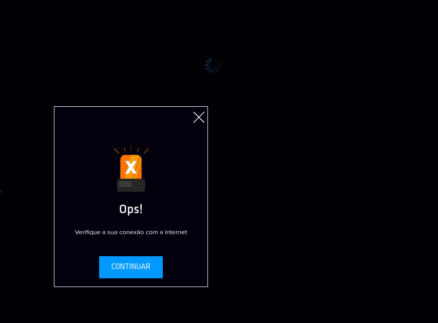

> Publicado originalmente no [Medium](https://medium.com/@kellenxaviier/teste-de-performance-uma-breve-an%C3%A1lise-do-site-ingresso-com-90e89aacb9e6) em 4 de fevereiro de 2023. Este registro preserva o texto e as imagens do artigo original.

*Análise para estudos e aplicação no trabalho sobre testes de software.*

## Um exemplo real para aplicar Testes de Performance

Ao longo da última década o crescimento do online shopping cresceu exponencialmente, cada vez as pessoas aderem mais ao método de compra virtual em vez de comprarem na loja física. A pandemia do covid-19 gerou um impulso nesse modelo de compra, tanto em aumento de compras por já adeptos quanto atraindo novos consumidores. Isso tudo gera um fluxo muito maior nas páginas e servidores, levantando a necessidade de uma solução robusta, segura e com bom desempenho.

Além de um fluxo muito maior no dia a dia comparado ao que era usual, também temos picos de acessos em datas e épocas específicas ao longo do ano, como feriados, datas comemorativas, e grandes eventos. Infelizmente não é comum ver um gargalo em grandes portais de venda, ocasionando em lentidão extrema, falhas de autenticação e quedas da página.

Hoje vamos falar sobre a Black Friday e a Ingresso.com, esses serão nossos exemplos para nos aprofundarmos em **Testes de Performance**. A Black Friday é um evento que ocorre sempre na última sexta-feira do mês de novembro. As lojas online precisam estar preparadas para a alta demanda que é esperada, é inadmissível que já saibamos com tanta antecedência que teremos um pico de fluxo e mesmo assim não estejamos preparados para isso, gerando uma experiência negativa para o cliente e deixando de obter maiores lucros para o negócio — devido tanto a frustração do usuário, evitando futuro retorno na plataforma, quanto ao servidor não sendo capaz de realizar a transação da compra.

### Problemas como

- Queda no servidor;
- Lentidão na Navegação;
- Lentidão no Fluxo de compras (a ponto de não conseguir realizar a compra);
- Instabilidade;
- BUGs;

## Um exemplo real de quando não fazemos Teste de Performance

Por volta do meio-dia (horário de pico) em 29 de novembro de 2021, o site ingresso.com, uma das maiores páginas de vendas de ingressos de cinema, não aguentou a quantidade de acessos simultâneos para as compras dos ingressos na pré-venda do filme mais aguardado do ano.

A instabilidade foi tanta que houve pessoas que ficaram *mais de 1 hora para realizar a compra*. Alguns que conseguiram realizar o fluxo de compra tiveram o valor descontado mas não receberam os ingressos, e tiveram que solicitar o estorno do valor.

### Outros problemas ocorreram também, como

- Queda no servidor — impossibilitando o usuário de acessar o site;
- Fluxo principal incompleto (não conseguir realizar a compra);
- Carregamento infinito (lentidão no fluxo de compra, voltando para a queda do servidor);

### E muitos BUGs

- Deslogar da conta — no meio do fluxo de compra acontecia o logout forçado, muitas vezes sem nem informar ao usuário, gerando conflito na compra;
- Redirecionamento de página — alterando a localidade da sessão da compra, novamente sem o usuário ser informado;
- Filme não está mais disponível — exibindo como se o filme não estivesse mais em cartaz;
- Mensagens Genérica — o erro ocorria ao usuário, porém a mensagem informada não era nada precisa, sendo a mesma para diversos erros diferentes, gerando frustração no fluxo;

### Foi tão grande a instabilidade que gerou alguns memes

### Já outros não estavam tão contentes assim…

### Postagem: nota de esclarecimento do site ingresso.com

> Os Teste de Performance no sistema servem para que não ocorram essas situações citadas, para manter a qualidade e escalabilidade da aplicação!

### Existem alguns tipos de testes de performance. São eles

- Teste de carga;
- Teste de estresse;
- Teste de longa duração ou resistência;
- Teste de configuração;
- Testes de Regressão — Ciclo de testes validar melhoria no seu desempenho;

Quando se faz o planejamento de testes no sistema, deve-se pensar nos testes de regressão também. “Qual o core do seu sistema?”, “Qual funcionalidade não pode parar?”. Responder a essas perguntas pode ajudar a saber onde focar nos testes regressivos. Além dos testes regressivos, vale destacar ter uma cobertura *mínima de testes unitários, para garantir que novos bugs não sejam introduzidos nas correções solicitadas/requeridas pelos testes de Performance.*

> Sobre os testes regressivos, faça automação end-to-end no principal fluxo, converse com os desenvolvedores para cobrir com testes unitários.

Neste exemplo do ingresso.com já era esperado, devido ao ‘hype’ em cima de uma grande estreia, um alto fluxo de acessos. Outro exemplo usado anteriormente foi o da *Black Friday,* que possui um grande número de acessos para as compras.

> O exemplo dado [neste vídeo](https://youtu.be/o_FMy9NT_XU?t=2144) de referência, comenta sobre os testes rodados no ifood, que são feitos testes em cada minuto, do principal fluxo; fazer um pedido. Isso não pode parar na aplicação. Neste caso é planejado que esses testes devem ser rodados.
>
> **PS**: este texto é utilizado apenas para análise e estudos de um acontecimento. Não é uma tentativa de denegrir o ingresso.com

## Fontes

*Leituras Testes de Performance*: <https://www.testar.me/teste-de-performance>

*Páginas de Memes*: @superhelandia, @lastimarvel, @nerdonautas\
*Referências*: ingresso.com (site e instagram)

*vídeos de referência e estudos*:\
[168 — Software no iFood com Braca: Arquitetura e Testes! \| theWiseDev-chat](https://youtu.be/o_FMy9NT_XU?t=2144)

[Como fazer o Ingresso.com escalar? \| Conceitos Intermediários de Web](https://youtu.be/0TMr8rsmU-k)\
Vídeo acima de análise do ingresso.com com [enfase em Testes](https://youtu.be/0TMr8rsmU-k?t=2797)
