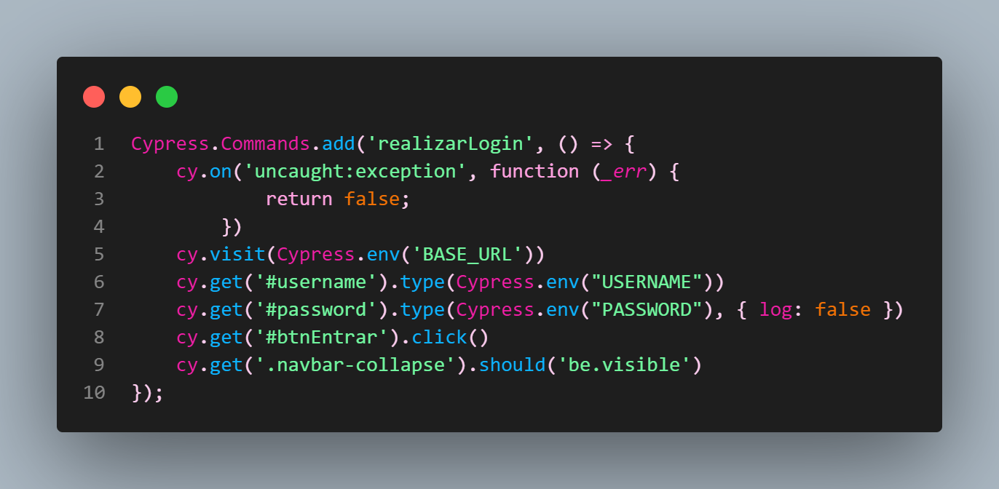
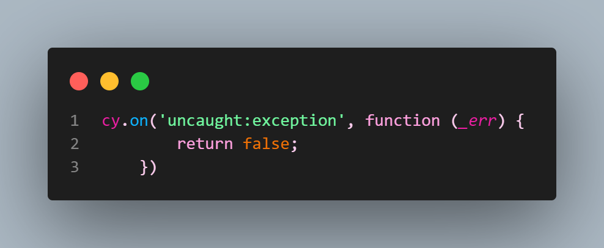
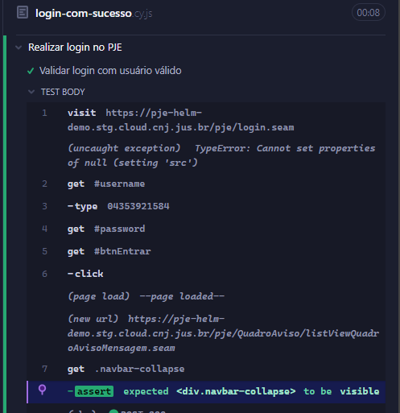

Avoiding *false positives* with Cypress. Below is an example of some code and a commands file with a simple application login:



This application was encountering an error during login. The following code was added to the automation to make login succeed:



But what does that code mean? It suppresses errors that occur in the application while Cypress tests run.

How? Using `cy.on('uncaught:exception')` and returning false tells Cypress to ignore errors in your application. This allows the test to continue even if the page has not fully loaded, giving elements time to render before Cypress tries to interact with them.

Why is removing `cy.on('uncaught:exception')` important? In this case, manipulating the test to ignore the error by returning false introduces a false positive. See below:



## Alternatives for handling loading time and avoiding false positives

Instead of suppressing errors, use Cypress tools to ensure elements are present and ready for interaction before trying to access them. Some options include:

`cy.wait()`: wait for a specified time or for a particular element or condition before continuing the test.

Note: watch out for poor practices when using `cy.wait(number)`. Read the documentation on this anti-pattern.

[Unnecessary waiting](https://docs.cypress.io/app/core-concepts/best-practices#Unnecessary-Waiting)

Instead, use:

```bash
cy.intercept('GET', '/users', [{ name: 'Maggy' }, { name: 'Joan' }]).as('getUsers')
cy.get('[data-testid="fetch-users"]').click()
cy.wait('@getUsers') // <--- wait explicitly for this route to finish
```

`cy.get(...).should('exist')` or

`cy.get(...).should('be.visible')`

Make sure the element exists and is visible on the page before trying to interact with it.
