I am applying these studies to the strength training studio I attend in northern Porto Alegre. I asked the owner, who started the business in January 2025, for permission to apply the studies and develop a project for a real business with real needs.

---

**The project:** create a landing page for the studio, applying Design Thinking techniques and the material from Innovation and Entrepreneurship — Inovação e Empreendedorismo - Web 03.

**Project beginnings:** I followed the studio's opening from January 2025. Since then, a close friend and I have been members training at the new location. The first things I asked the owner were: how will the gym work? Will there be flexible hours? Who will train here?

I tried to understand this better by talking to the owner of the strength training studio and asking these questions. Another important point is that I have trained there from the start. Since I knew the owner, I was the studio's test member 😂. That helped the project because I experienced some important issues firsthand.

### 1. Empathy — Understand the problem from the user's perspective

As a gym member, I ran into questions: what are the prices? How do the packages with nutritional support work? Are there partnerships with supplement stores? How much does whey protein cost? And others. I noticed that later members had the same questions. When recommending the gym, I also struggled to share its address and quote prices from memory. I only knew what I used myself, which was TotalPass. There was no central place to consult this information.

### 2. Define — Refine the problem

Based on this, I organized the information I had and talked to the owner to understand and refine the questions. Using design thinking techniques, I applied the **Value Proposition Canvas** to get the ideas out of my head and share them with the person involved: the business owner. See below:

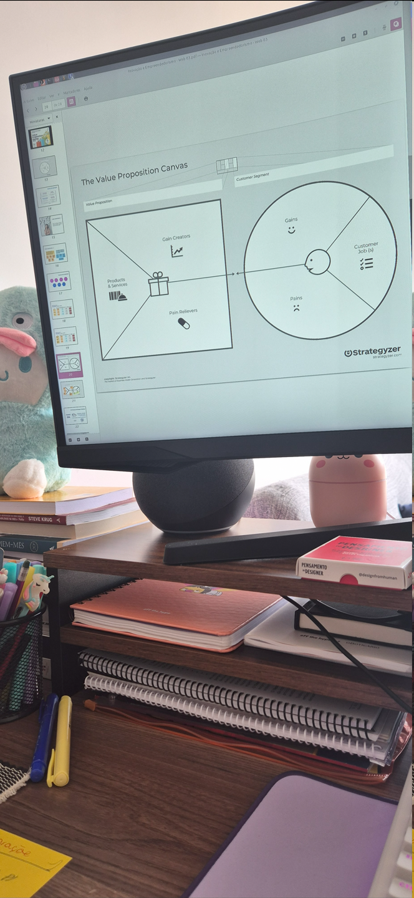

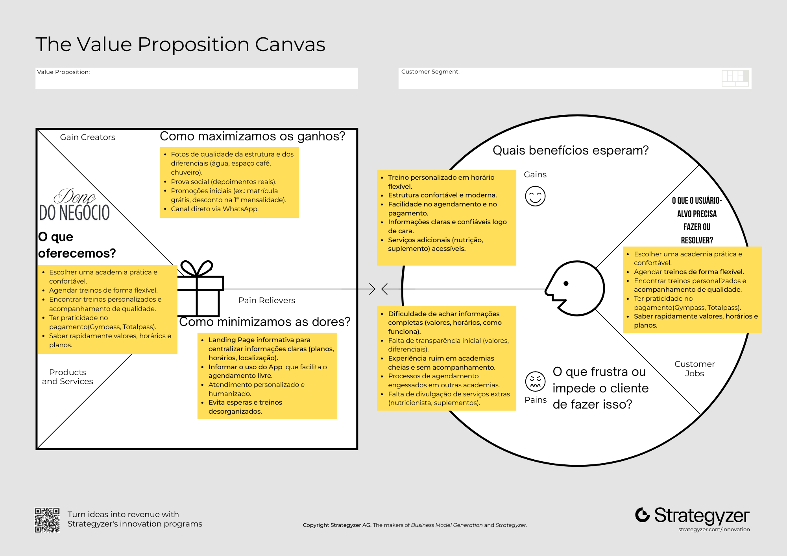

I also used ChatGPT to structure the details and organize the information in the appropriate places, so I would not lose focus on the details.

### ChatGPT

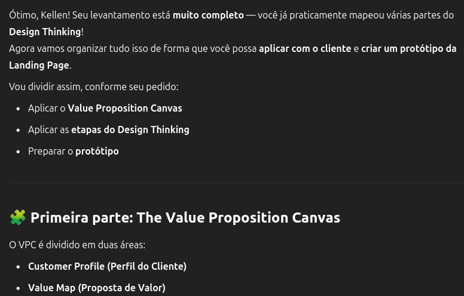

Below, I used a checklist of the information I had already mapped to stay organized throughout the process:

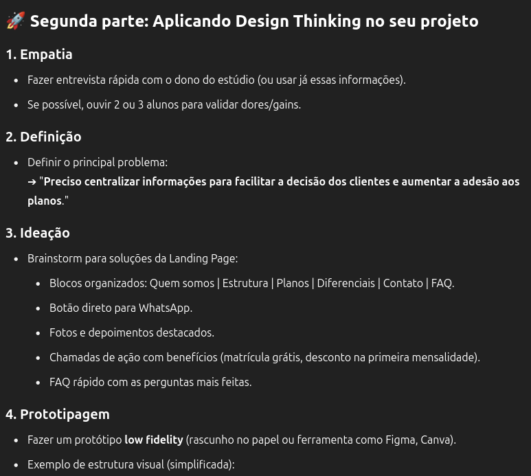

To make the interview clearer, I decided to create a form for the owner to answer. **This corresponds to the "Define" stage mentioned and applied here.**

---

### 3. Ideate

The ChatGPT output above gives us the following:

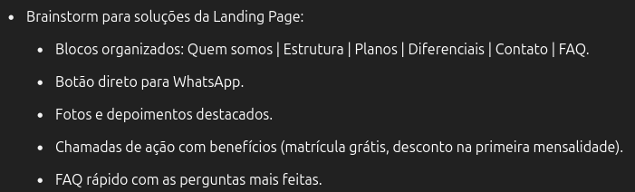

I will reorganize some points I consider important based on the needs mapped with the **Value Proposition Canvas**.

Landing page solution brainstorm, edited:

- Organized sections: About us | Plans and advantages | Facilities | Booking and contact | FAQ.
- A direct WhatsApp button.
- High-quality photos of the space to build credibility.
- A call to action highlighting the business's distinguishing feature: a free fitness assessment.
- A quick FAQ with questions raised by new users, collected through the form.

---

### 4. Prototype

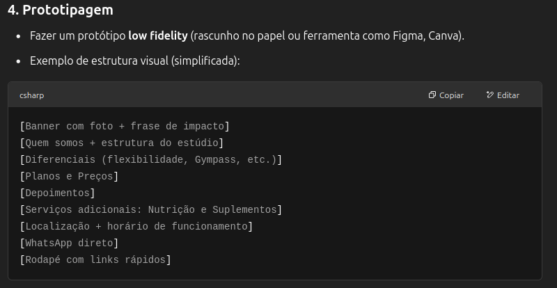

I am terrible at design 😭, **so I used Canva to bring this to life** instead of letting that stop me.

**Note:** a quick reminder of the live class discussion: "Great, let's go and do it."

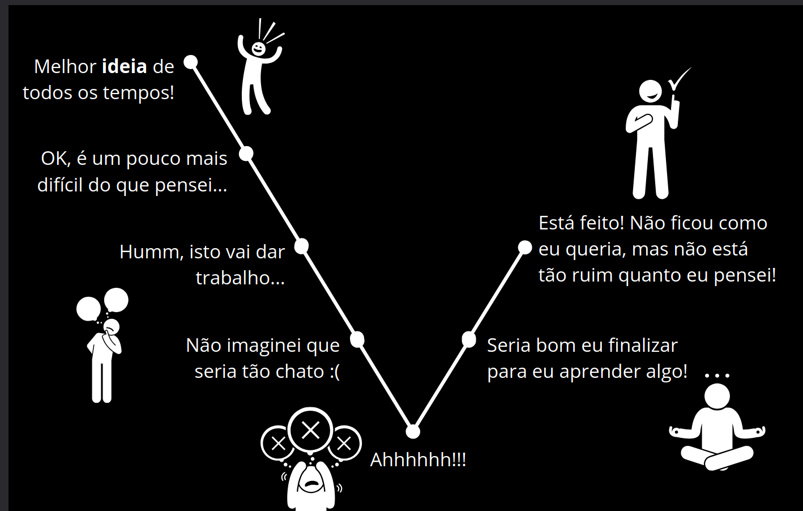

I do not know design.

---

## 5. Test

Creating the prototype: as mentioned, this prototype was made in Canva to visualize the planning from the Value Proposition Canvas. Below is the screen sequence:

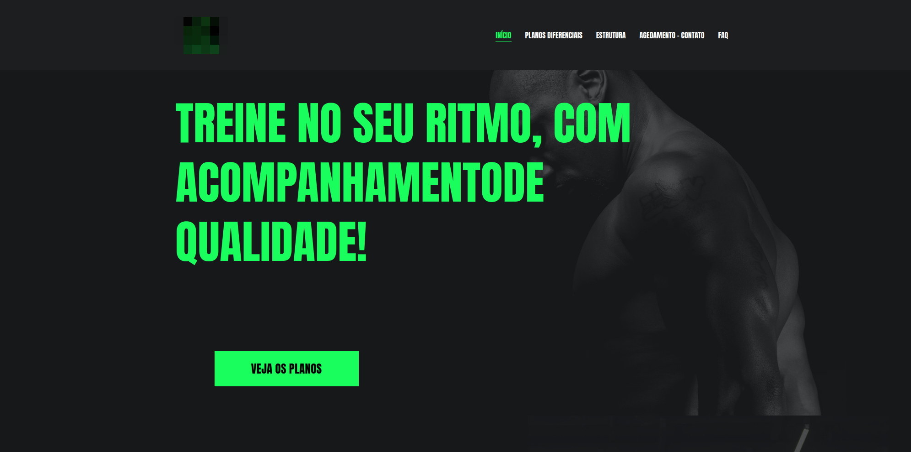

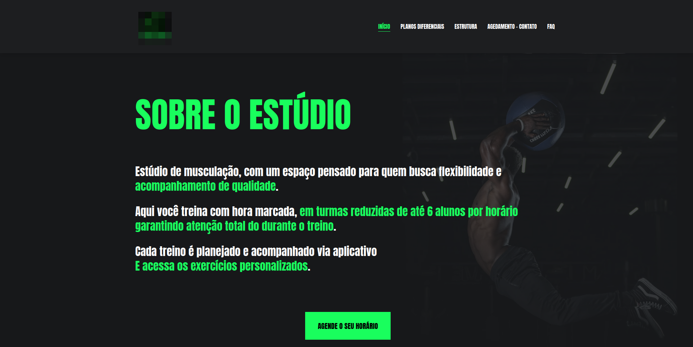

Include the remaining service information once the form has been answered.

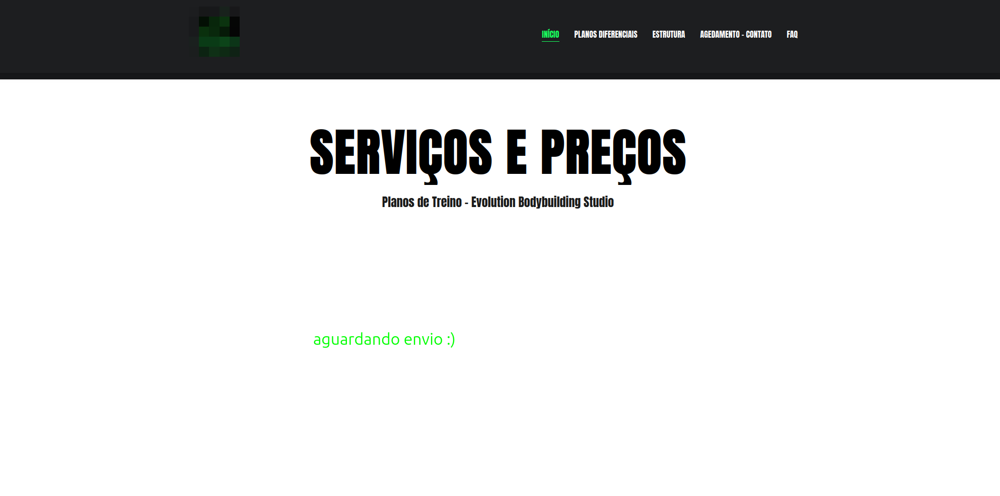

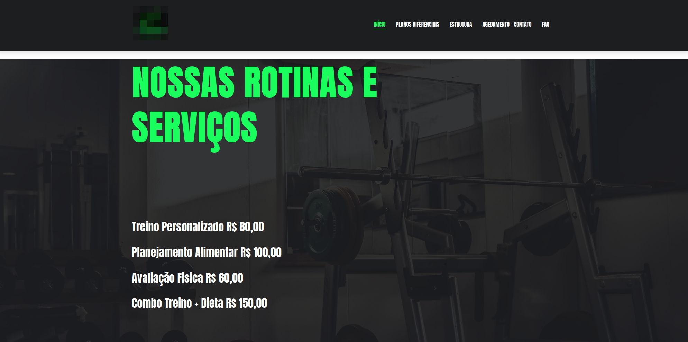

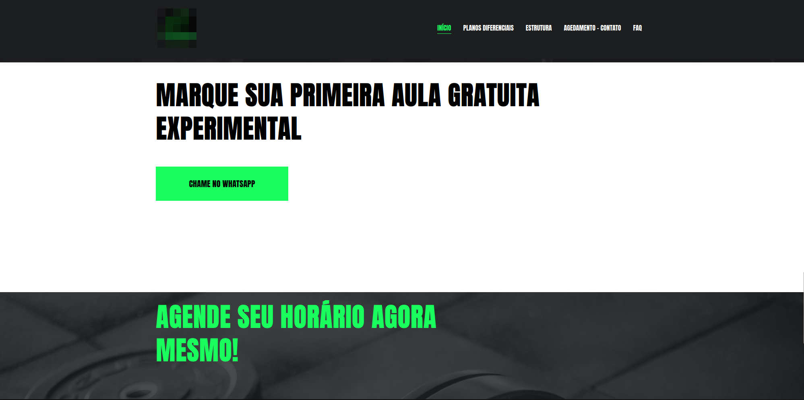

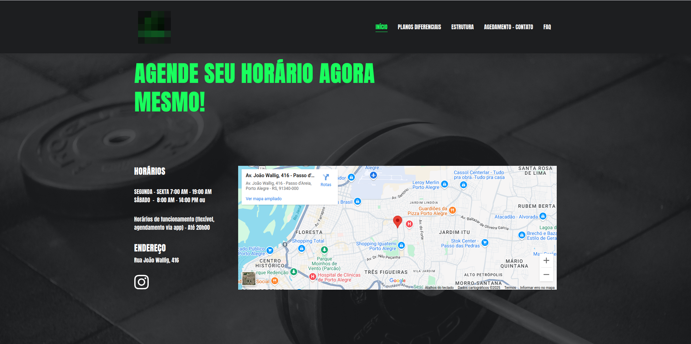

This initial prototype draft was developed to validate the owner's needs for serving customers.

Building the prototype helped identify relevant points and, above all, represented significant progress by turning ideas into a practical, visual version. The process was quick and functional, helping guide the next steps.

The proposed continuation is to run more user tests and deploy the site in a real environment to assess whether the implemented features meet the previously mapped needs.

**Canva prototype:** [link](https://testeladybug.my.canva.site/cada-rotina-e-pessoa-diferente-por-isso-nos-certificamos-de-que-voc-possa-escolher-um-plano-que-funcione-melhor-para-voc)

---

## Form research for better analysis and understanding

## 2. Design thinking questionnaire

For use in the **Empathize and Define** stages with the client.

### Questions about the business

1. How would you describe your studio's mission and values?
2. What is the main difference between your studio and other gyms?
3. Which services or advantages would you most like to highlight to new members?
4. What feeling or impression would you like members to have when visiting the studio?

### Questions about customers

1. Who are your main customers today? Consider age, profile, and goals.
2. What do members praise most about your service?
3. **What questions or concerns do prospective members most often express when contacting you?**
4. What positive or negative feedback have you received about the gym experience?

### Questions about communication

1. Which channels do you currently use to promote the studio? Instagram, WhatsApp, referrals, or others?

### Questions about additional services

1. How does the nutritionist partnership work? Consider prices, appointments, and distinguishing features.
2. How does the supplement partnership work? Consider brands, discounts, and benefits.

### Questions about experience

1. What benefits would you like to offer new members? Promotions, a trial class, or a first-month discount?

---

## Reference links

**See the website prototype:** [https://site-academia-app.vercel.app/](https://site-academia-app.vercel.app/)

Website research for the fitness studio market — [link]().

**Study references:**

- Product quality, Rian Dutra: [LinkedIn](https://www.linkedin.com/posts/riandutra_prestes-a-falir-cortam-o-design-e-marketing-activity-7315692085477539840-InMr)
- Book: *Don't Make Me Think*, Steve Krug.
- Book: *The Design of Everyday Things*, Donald A. Norman.
- Book: *Value Proposition Design*, pages 142, 228, 232.
- Unisinos postgraduate course: Innovation and Entrepreneurship classes with [Professor Rosemary Francisco](https://www.linkedin.com/in/rmaryf).
- Tools: [Canva](https://www.canva.com/) and Vercel App for site deployment.
- [How to identify and solve user pain points in UX design](https://psicologia.design/como-identificar-e-resolver-pontos-de-dor-user-pain-points-do-usuario-no-ux-design-com-psicologia-aplicada/)
- [How to use storytelling in UX design](https://psicologia.design/como-usar-storytelling-no-ux-design/)
