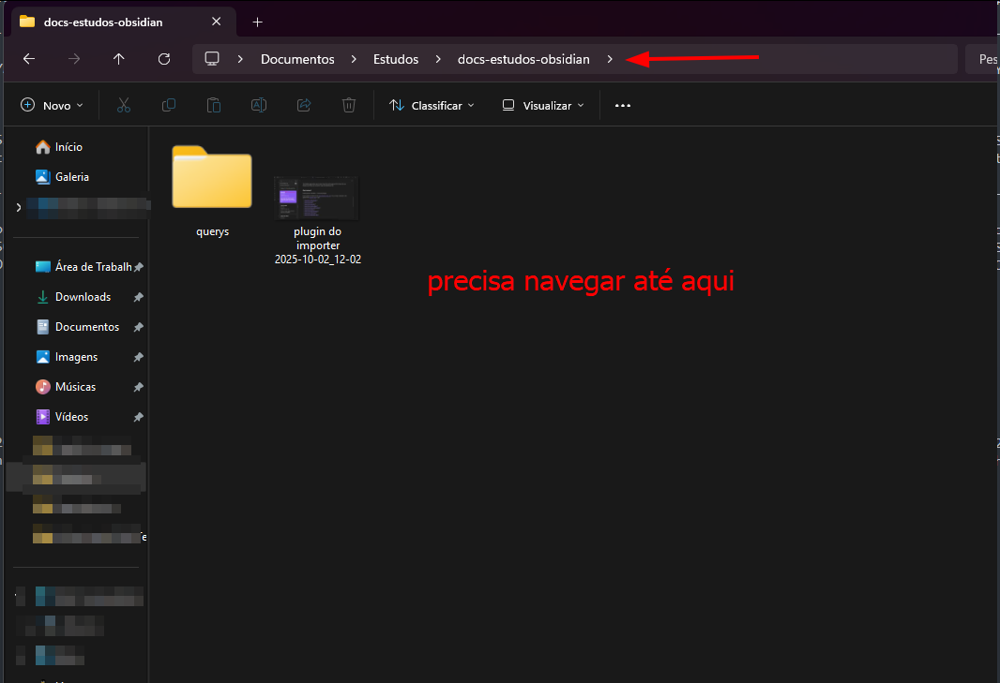
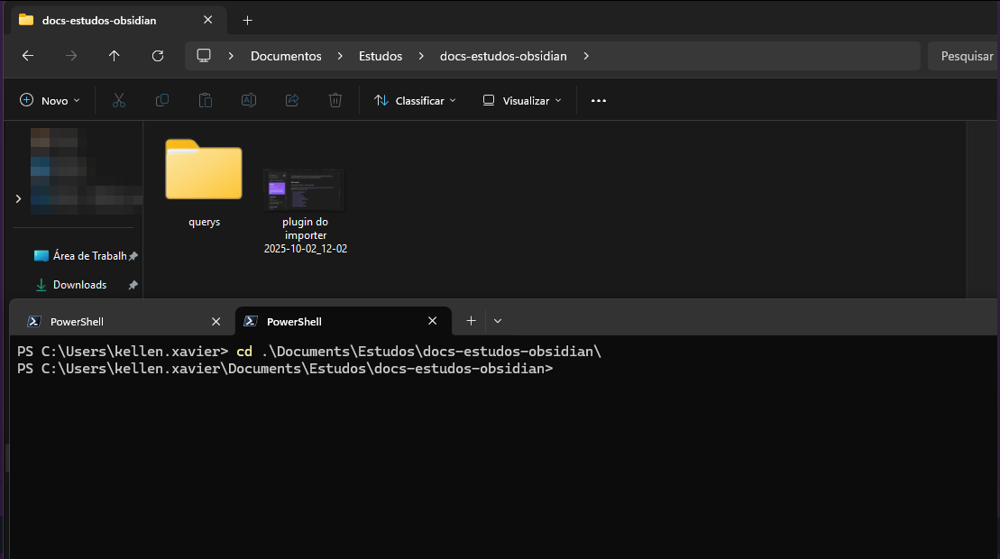

This post started as a few practical Git commands for everyday use. But I had no written collection of terminal studies either: what a terminal is, how to use one, and where to read more before getting into Git commands.

*I always say it is important to know how to use the terminal. At a minimum, we need to know how to use these tools. There is no avoiding it, even if your IDE is perfect and entirely visual, because we will inevitably face problems outside the visual interface.*

I like the driving analogy: imagine you are driving a car, it beeps and stops, and you need to open the hood to find out what happened. It could be a fully automatic BYD, but the car still contains logs and a black box called an EDR, Event Data Recorder. Here I use the expression "get your hands dirty" and encourage not being afraid of these commands. Understanding what happens under the hood brings much deeper clarity.

---

## Some important basic concepts

### What is a terminal?

A terminal is a text interface for interacting directly with the operating system. It sends commands to a shell, such as Bash, Zsh, or PowerShell, which interprets and executes instructions through system APIs.

### Terminal references — Reading and videos

[Wikipedia](https://pt.wikipedia.org/wiki/Terminal_(inform%C3%A1tica))
[[Akitando] #70 — Understanding Git, not a tutorial](https://akitaonrails.com/2020/02/05/akitando-70-entendendo-git-nao-e-um-tutorial/)
[[Akitando] #71 — Using Git properly and cleaning up commits](https://akitaonrails.com/2020/02/12/akitando-71-usando-git-direito-limpando-seus-commits/)

### File system and navigation

Generally, navigating in a terminal means entering and leaving folders and handling files. It is like navigating a visual interface, but with commands. When we say "do this in the project/automation repository", we mean inside that folder.



Visually, we have a screen and somewhere to navigate. When opening a terminal on Windows, for example, you may see `C:\Users\meu.nome\Sua-pasta`. In the screenshot, this would be something like `C:\Users\kellen.xavier\Documents\Estudos\docs-estudos-obsidian`. My personal organization puts projects in Documents, inside the study folder. So when I say "enter the Obsidian study project and run git pull", that is the location I mean.

For example, here is a folder I need to reach through the terminal. When opening it, most people will see something like:

```text
PS C:\Users\kellen.xavier>
```

Then we use commands to navigate there.

### Commonly used commands

Navigation:

```text
pwd        # mostra o diretório atual
ls         # lista arquivos e pastas
ls -la     # lista detalhada (inclui ocultos)
cd pasta   # entra na pasta
cd ..      # volta um nível
cd ~       # vai para a home
```

In order, these commands show the current directory, list files and folders, show a detailed listing including hidden files, enter a folder, go up one level, and go to the home directory.

**Clicking the address bar shows the path starting from kellen.xavier**, in my case. My location is `C:\Users\kellen.xavier\Documents\Estudos\docs-estudos-obsidian`, so in the terminal:

```powershell
cd Documents\Estudos\docs-estudos-obsidian
```

Now I have entered the folder:



---

## Git

Here is a sequence of useful commands, especially when working on projects with more than one contributor. Do not forget them.


**To merge your current branch into the main branch, follow these steps:**

```bash
git checkout sua-branch
$ git fetch origin # Puxa as últimas informações do repositório remoto
$ git rebase origin/main
# Atualiza sua branch com as alterações da branch main

$ git rebase origin/main   # Atualiza sua branch com as alterações da branch main
```

**After updating your development branch, use git checkout to switch to develop or main:**

```bash
git checkout develop
```

**Now you are on develop. Merge your development branch with this command:**

```bash
git merge sua-branch
```

---

## A brief note on pull requests

Creating a pull request, PR, on GitHub or another version control platform **proposes changes collaboratively and in a controlled way**. A PR asks for changes on a specific branch to be reviewed and, if approved, merged into the project's primary branch, such as main or develop.

---

**Consider this scenario:** if you need to work specifically on a branch **other than main**, create a local branch based on the desired remote branch. Suppose you want to work on minha-branch.

**Use this Git command:**

```bash
git checkout -b minha-branch origin/minha-branch-remota-desejada
```

This creates a local branch called `minha-branch` based on the remote `origin/minha-branch-remota-desejada` branch.

You can then work on the **local branch**, committing and performing other operations as usual.

---

**Everyday commands:**

Before starting development, update your local environment from the remote repository.

```bash
git pull
```

This updates the local environment with changes made by the project's other contributors.

The git pull command fetches the latest changes from a remote repository and then merges them into your current branch. In other words, it combines `git fetch` and `git merge`.

Another git pull example:

```bash
git pull <remote> <branch>
```

Here, `<remote>` names the remote repository you want to pull from, usually `origin`, and `<branch>` is the remote branch, such as `main` or `develop`.

### Committing changes

To send changes to the remote repository, stage them and write a message describing what changed.

Stage a change:

```bash
git add .
```

⚠️ Be careful with `git add .`: it stages every change. Avoid using it indiscriminately; prefer:

```bash
git add nome-do-arquivo-ou-pasta
```

Then write the commit message:

```bash
git commit -m "padrao-de-commit: minha mensagem"
```

**Read more about commit conventions here; the link will be added later.**

Now check your terminal. If there are no errors or conflicts, upload the changes:

```bash
git push
```

To merge your branch into `main` in the repository, use:

```bash
git merge sua-branch
```

---

## About git stash

The `git stash` command temporarily stores changes from your working directory, allowing you to return to the repository's earlier state without committing them. This is useful when switching quickly between tasks or branches while preserving work that is not ready to commit.

Here are some examples:

**Temporarily store changes:** if you have made changes but do not want to commit them yet, use:

```bash
git stash save "Descrição opcional"
```

The description is optional and helps identify why you stashed the changes.

**List stashes:** list the stashes you created:

```bash
git stash list
```

**Apply a stash:** apply the most recent stash or a specific one:

```bash
git stash apply           # Aplica o stash mais recente
git stash apply stash@{n} # Aplica um stash específico pelo seu índice
```

**Remove a stash:** after applying one, you can remove it:

```bash
git stash drop           # Remove o stash mais recente
git stash drop stash@{n} # Remove um stash específico pelo seu índice
```

**Create a branch from a stash:** create a new branch based on a stash:

```bash
git stash branch nova-branch  # Cria uma nova branch e aplica o stash nela
```

---

**Other important points:**

Update your **branch** with **the latest changes from main** to help **avoid merge conflicts**:

```bash
git fetch origin # Puxa as últimas informações do repositório remoto

git rebase origin/main   # Atualiza sua branch com as alterações da branch main
```

⚠️ **Attention**

Do not use git pull in these situations. Read the explanation of **git pull** again.
