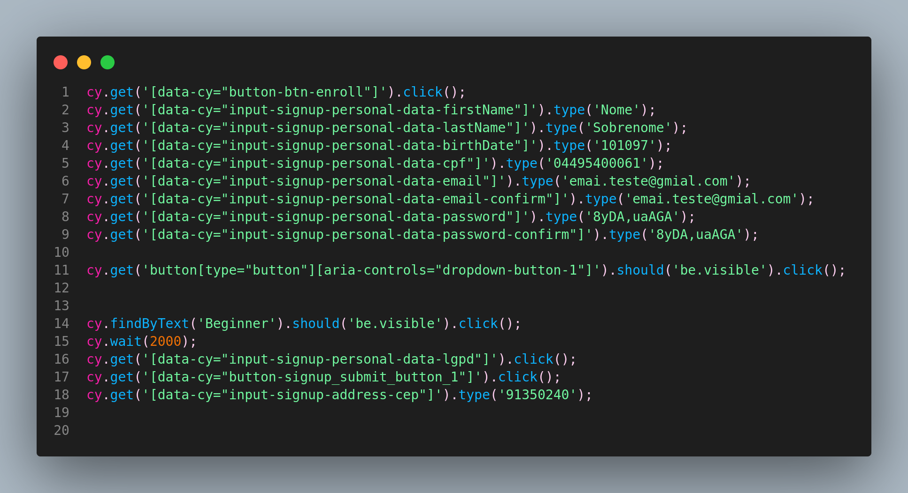

Below is an example of code that uses `data-cy` to locate elements in Cypress E2E automation.

---

Using **Testing Library** is useful when an element has not been defined for E2E testing, meaning it has no data-test/cy attribute. For Testing Library to recognize it in the automation, the element Cypress searches for should not have `data-cy`; Testing Library then finds it using the pattern `findByText.('Sua palavra mágica').click();`.



**Option 1 — Configure the `setup-tests.js` file, Cypress v10+:**

1. Create `setup-tests.js` if it does not exist, in the project root or another location specified by your Cypress configuration. See the documentation for details.
2. Configure the `testIdAttribute` attribute:

```javascript
// cypress/support/setup-tests.js
import { configure } from '@testing-library/cypress';

configure({ testIdAttribute: 'data-cy' })
```

**Option 2 — Configure it directly in the test, Cypress v9 and earlier:** if you use an older Cypress version, configure the library in the test file:

```javascript
// cypress/e2e/seu_teste.cy.js
import { configure } from '@testing-library/cypress';

// ...

describe('Seus testes', () => {
  before(() => {
    configure({ testIdAttribute: 'data-cy' })
  })

  // ... seus testes aqui
})
```

**Option 3 — Create a new command:**

Create a custom command that always uses `findByTestId` with `data-cy`:

```javascript
// cypress/support/commands.js
Cypress.Commands.add('findByCy', (value, options) => {
  cy.findByTestId(value, { ...options, testIdAttribute: 'data-cy'})
})
```

---

**References:**

[Testing Library](https://testing-library.com/docs/cypress-testing-library/intro/)

<https://github.com/testing-library/cypress-testing-library/blob/97939da7d4707a71049884c0324c0eda56e26fc2/cypress/integration/find.spec.js>

**Cypress and Testing Library** [Link](https://docs.cypress.io/app/core-concepts/best-practices#Cypress-and-Testing-Library)
