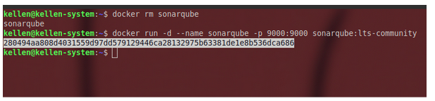
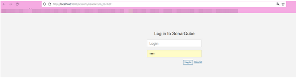
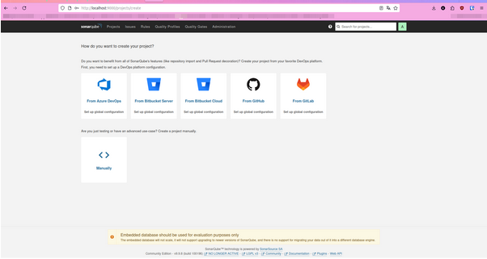
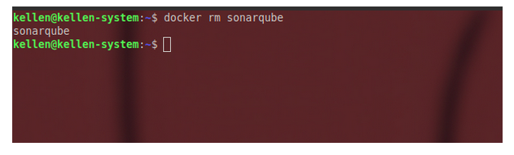
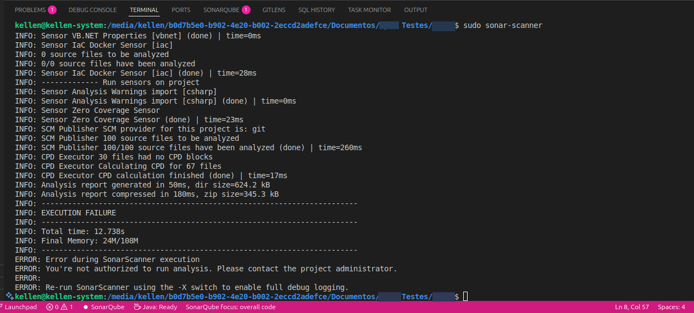
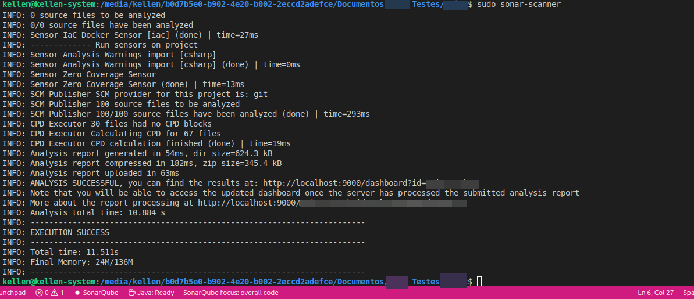
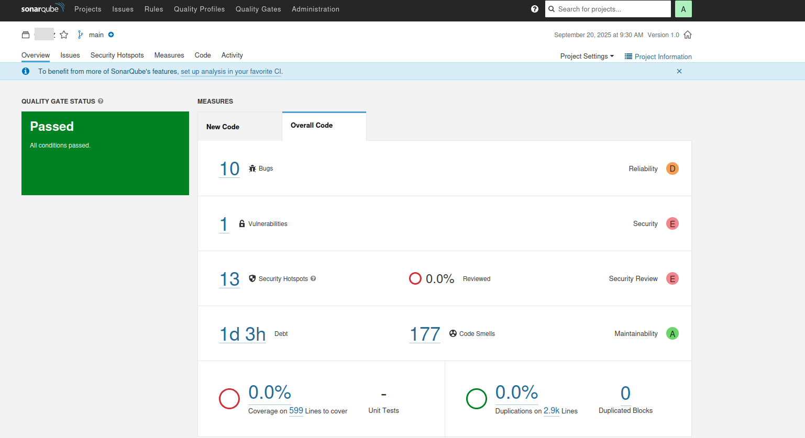

**This is not a tutorial.** These are study notes on understanding the tool and applying it to small and medium-sized projects in private repositories. Since I already had SonarQube installed on my machine, here is how I configured Docker.

---

## Option 1 — Remove the existing container

I had configured it for a code analysis study project as part of my postgraduate coursework. In this case I reconfigured it for another project; later I will set it up correctly again for the code analysis project.

`docker rm sonarqube`



Now I can run the command to start a new container:

`docker run -d --name sonarqube -p 9000:9000 sonarqube:lts-community`

> Yes, this is the free version, for learning before paying for something I do not yet know how to use.



### Option 2 — Replace the container automatically

To force replacement, use `--rm`, which removes the container when stopped, or `--replace` with Podman. With Docker, we generally remove it manually as above.

### Option 3 — Check the container status

`docker start sonarqube`

To stop it, use:

`docker stop sonarqube`

## Run SonarQube locally

Now for the interesting part: configuring SonarQube locally and running a basic scan.

First, some initial configuration. I think this is worth adding to the development setup script.

### 1. Prerequisites

- **Java 11 or later** installed on the machine; SonarQube needs Java to run.
- **Docker**, optional but it really makes running SonarQube easier.

### 2. Download and run SonarQube

Download: [SonarQube Community Edition](https://www.sonarsource.com/open-source-editions/sonarqube-community-edition/)

The first step is adjusting Docker, so make sure it is running correctly without problems.

`docker run -d --name sonarqube -p 9000:9000 sonarqube:lts-community`

Done! SonarQube is running locally.



Adjust the password settings and continue to the page:



### SonarQube configuration

- Open [http://localhost:9000](http://localhost:9000/).
- Default login:
   - Username: admin
   - Password: admin

Now let's configure a project scan.

### Generate an authentication token

1. In the top-right menu, click your user > My Account > Security.
2. Under "Generate Tokens", create a token, such as nome-projeto-token.
3. Save the token; the scanner will use it.

### Install SonarScanner

**SonarScanner** is the CLI that sends your code to SonarQube. Through the local terminal, we tell it to read the project and then obtain the analysis.

### Install through NPM for Node projects

`npm install -g sonarqube-scanner`

For project-specific references, see [SonarScanner documentation](https://docs.sonarsource.com/sonarqube-server/analyzing-source-code/scanners/sonarscanner).

### Configure SonarScanner in the project

Create a file called `sonar-project.properties` in the project root:

Example:

```jsx
sonar.projectKey=nome-projeto
sonar.projectName=Nome-projeto
sonar.projectVersion=1.0
sonar.sources=.
sonar.language=js,php
sonar.sourceEncoding=UTF-8
sonar.host.url=http://localhost:9000
sonar.login=SEU_TOKEN_AQUI
```

## Problems encountered



ERROR: You're not authorized to run analysis. Please contact the project administrator.

### What does this error mean?

SonarScanner is trying to send the analysis results to SonarQube, but the configured user or token **does not have permission** to perform this operation on the configured SonarQube project.

**Great! Let's see what I did wrong:** the project name in `sonar-project.properties` did not match the one I configured in local SonarQube.

Now it is ready: running `sonar-scanner` scans the project and displays the results.




