Continuing my **terminal and TUI studies**, here I explore CRUSH on a Windows machine: how I configured it and how it has worked so far. I tested it with a simple open-source repository for setting up a Windows development environment.

### Main goal

Let developers use **AI assistance directly in the terminal**, without switching to a web editor or an **IDE with integrated plugins**. It is also lighter to run than VS Code, for example. The tool offers:

- Integration with **multiple AI model providers**.
- **Sessions** with project context preserved.
- An optional interactive **TUI, Text User Interface**.
- A **traditional CLI** for automation or scripts.
- Extensibility through standards such as **Agent Skills** and **MCP, Model Context Protocol**.

**Source:** [Crush on GitHub](https://github.com/charmbracelet/crush)

### My first test on Windows

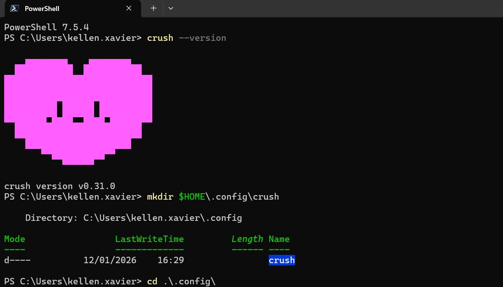

---

## Using it on a Windows machine

**Installation:** in PowerShell, I chose this command:

```text
# NPM
npm install -g @charmland/crush
```

That part was straightforward. To integrate the [OpenAI API](https://openai.com/pt-BR/api/), first create an [API key](https://platform.openai.com/api-keys). I followed [their Windows quickstart](https://platform.openai.com/docs/quickstart?desktop-os=windows). Copy your key and set it aside in a text note. After installing CRUSH on Windows, the configuration lives under `C:\Users\SEU_USER`, specifically `C:\Users\<SEU_USUARIO>\.config\crush\`.

If the folder does not exist, create it with `mkdir $HOME\.config\crush`. Then continue integrating an AI provider, OpenAI in this case. Below are the PowerShell commands for first creating an environment variable.

### Create an environment variable

`setx OPENAI_API_KEY "sua_chave_aqui"`

As usual, close the terminal and start a new one. Check it with `echo $Env:OPENAI_API_KEY`.

Check that Crush works with `crush --version`. If the version is displayed, start it:

```powershell
crush
```

PowerShell loads the tool's UI, and you can begin. For this test I decided to refactor a Windows setup project: <https://github.com/kellen-xavier/scripts-config-windows>. It is not particularly exciting, but it is necessary and useful when reinstalling the environment. First I downloaded the repository through VS Code. Yes, I used the editor for now, although the other [Charmbracelet plugins](https://github.com/charmbracelet) offer customization. That is not the focus here.

### Practical use

Ask about the current project's code. In this case, I went to my project folder:

```powershell
cd meu-projeto
crush
```

My first request was to analyze the project in general terms, looking for possible bugs. It then returned its findings.

> analyze possible errors

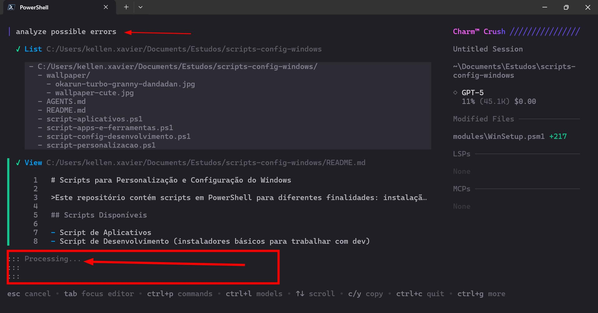

I had forgotten to create [AGENT.md](https://github.com/kellen-xavier/scripts-config-windows/blob/main/AGENTS.md). CRUSH itself recommends it on screen, so I went ahead and created it. This is the original instruction block:

```powershell
# Arquivo de script PowerShell para configuração Windows
Repositório de scripts voltado para Windows: instalar e personalizar via Shell Script. Este repositório foi criado com o intuito de facilitar a instalação de Aplicativos Windows. Criar o arquivo programas-new-apps.ps1

## REGRAS: O script deve conter
- Implementar Testes com Pester
- Usar análise estática de código
- Usar winget como gerenciador principal
- Instale programas com segurança usando winget
- Verificar se o winget está instalado
- Instalar programas de forma idempotente (não reinstalar se já existir)
- Usar parâmetros silenciosos
- Gerar log de execução
- Falhar de forma segura em caso de erro
- Não baixar executáveis diretamente da internet
- Seguir boas práticas de segurança no Windows
- Download e Execução de Script Externo com validação (Win11Debloat)
- Instalar gerenciadores de versão (Instalação de Múltiplas Versões do Java/Node.js)
- Deve conter blocos de help
- Script verifica conectividade antes de tentar downloads
- Adicionar Suporte a -WhatIf e -Confirm
- Transformar scripts em módulo PowerShell com funções reutilizáveis
- Consistência nos Nomes dos Scripts
- Verificação de Código de Saída (uso de $LASTEXITCODE para validar sucesso das operações winget)
- Feedback Visual ao Usuário (uso de Write-Host com cores para indicar status das operações)
- Todos os scripts principais possuem verificação de permissões administrativas no início
```

## List common software examples

### Work VPNs

- VPN: Netskope Client.

### Applications

Android Studio, BlueStacks 5, Bitwarden, Cursor, Docker Desktop, DBeaver Community, Discord, Flameshot, Global VPN Cliente, LibreOffice, Powershell, PowerToys Awake, Intellij IDEA Community Edition, ScreenToGif, sqldeveloper, Sublime Text Free, Teams, Insomnia, Obsidian, VS Code, Visual Studio Installer, Logitech G Hub.

### Browsers

Google Chrome, Edge, Firefox, Opera.

### Development languages

- JAVA 11, 17, 18+.
- NodeJS.
- Python.

## README.md documentation

- Specify the minimum Windows 10 version: 1809+ is required for winget.
- Require an up-to-date App Installer.
- Include troubleshooting.

### Registry backup

```shell
$BackupPath = "$PSScriptRoot\backup\registry-$(Get-Date -Format 'yyyyMMdd-HHmmss').reg"
reg export "HKCU\Software\Microsoft\Windows\CurrentVersion\Themes\Personalize" $BackupPath
```

## Correction priorities for the existing scripts

- Priority 1, security: add hash validation for Win11Debloat, back up the registry before changes, and implement Try-Catch in every script.
- Priority 2, functionality: implement persistent logging, add prerequisite checks, and correct the default-browser command.
- Priority 3, maintainability: add script parameters, implement idempotency, and add comment-based help.

## References

- [Examples of comment-based help](https://learn.microsoft.com/en-us/powershell/scripting/developer/help/examples-of-comment-based-help?view=powershell-7.5)
- [Native interoperability best practices](https://learn.microsoft.com/en-us/dotnet/standard/native-interop/best-practices)
- [Approved verbs for PowerShell commands](https://learn.microsoft.com/en-us/powershell/scripting/developer/cmdlet/approved-verbs-for-windows-powershell-commands?view=powershell-7.5)
- [PSScriptAnalyzer](https://github.com/PowerShell/PSScriptAnalyzer)
- [The test framework for PowerShell](https://pester.dev/)
- [Starting Windows PowerShell](https://learn.microsoft.com/en-us/powershell/scripting/windows-powershell/starting-windows-powershell?view=powershell-7.4#with-administrative-privileges-run-as-administrator)

I tried to include everything I understood to be appropriate for creating this setup. I also had to read the references to understand the best practices. It is important to understand exactly how to structure the AGENT file.

**Then I asked it to execute the AGENT file:** based on the AGENT.md file execute.

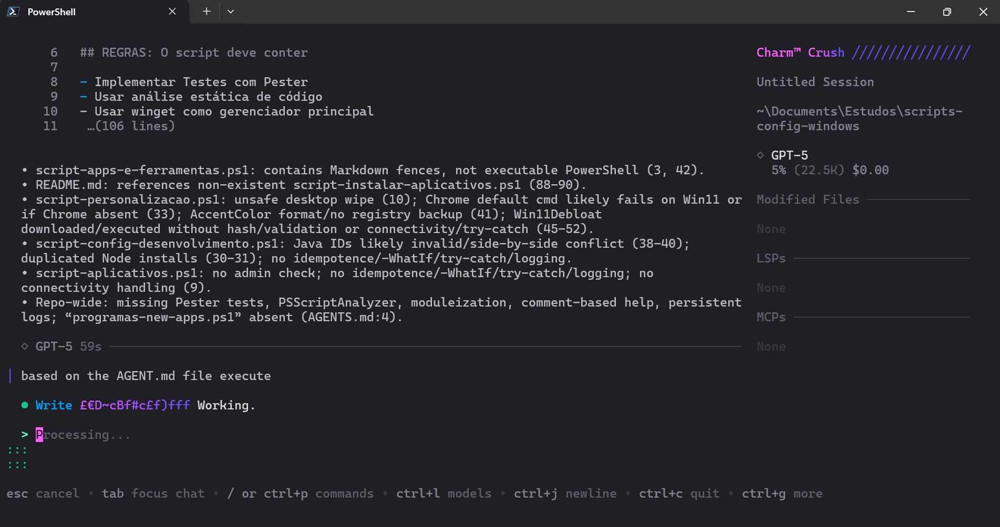

Based on the first command, it returned:

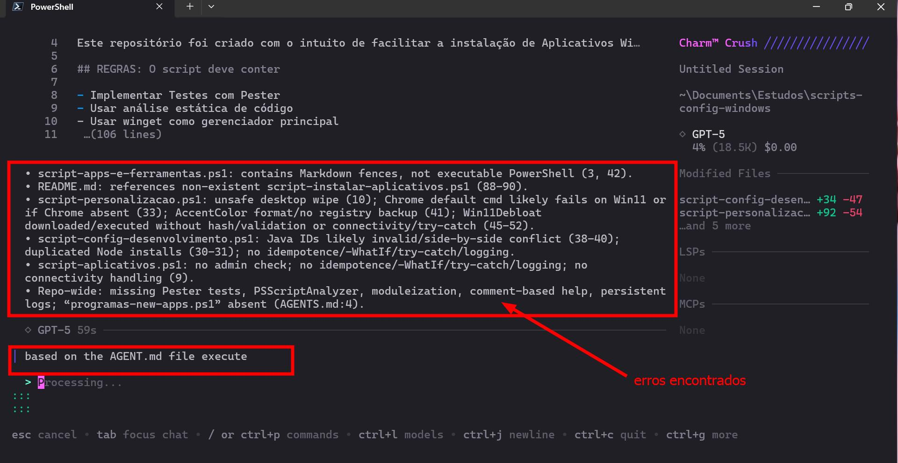

Processing the AGENT file:

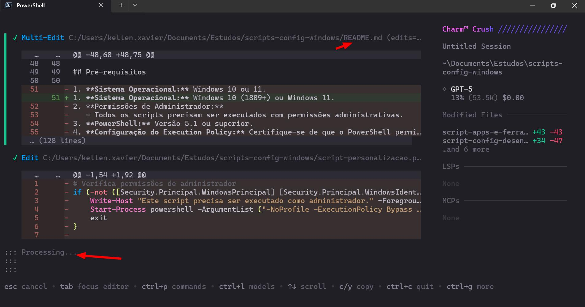

I opened VS Code to see how it was behaving:

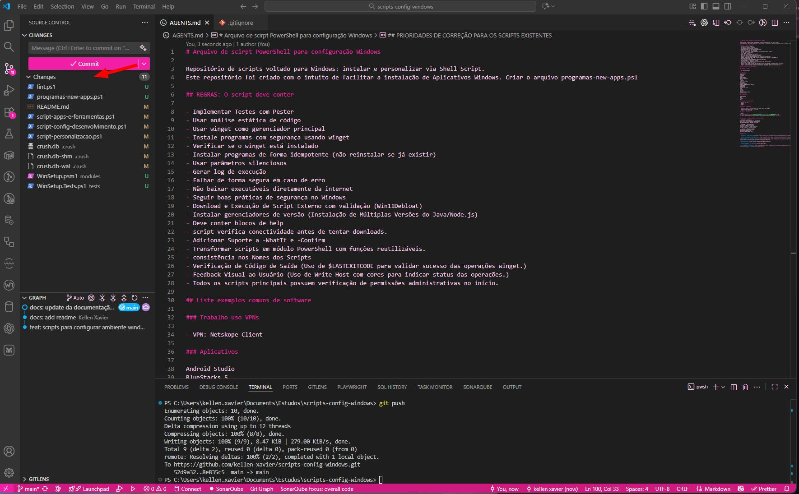

Running lint:

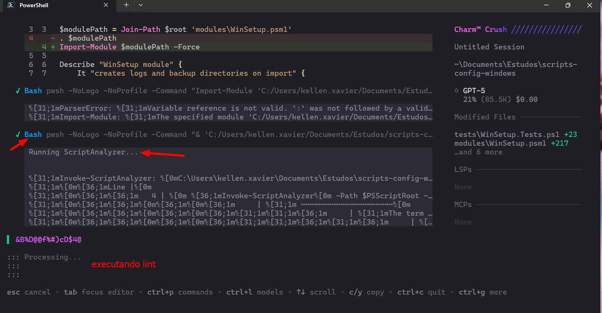

Running tests:

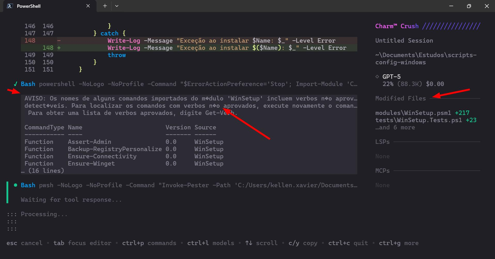

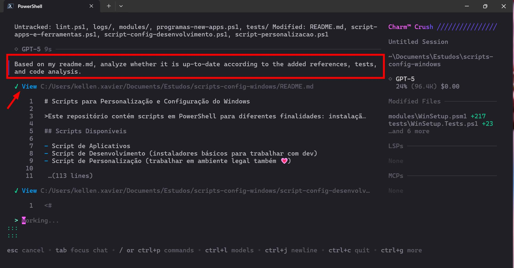

I asked for a README.md update:

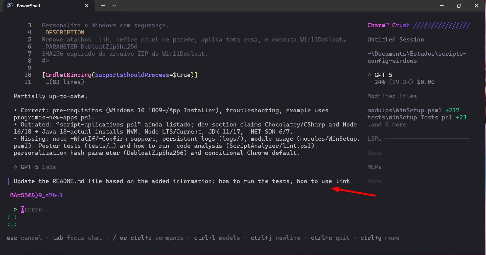

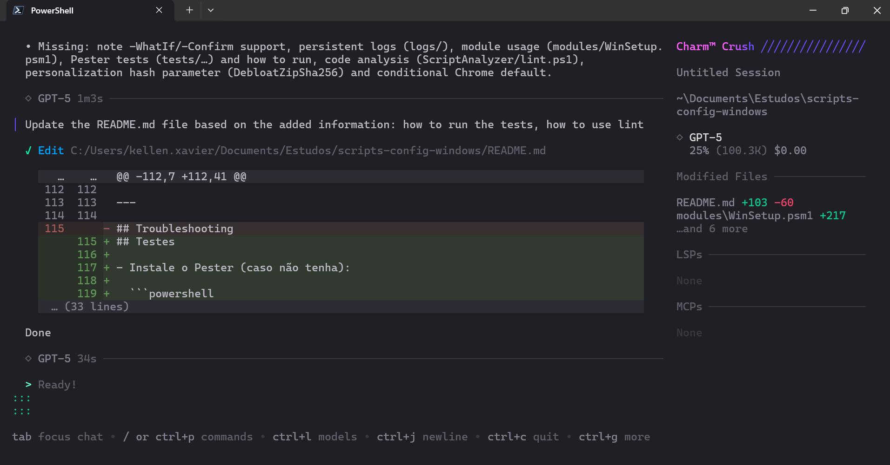

Final project structure:

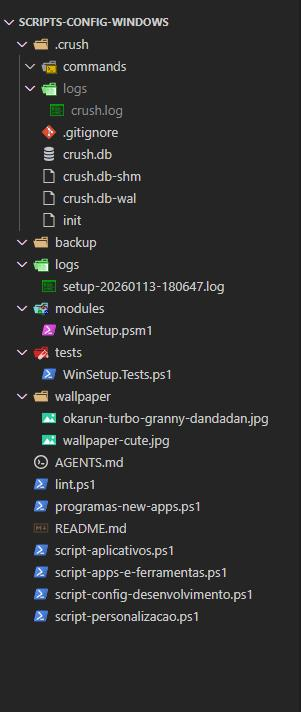
