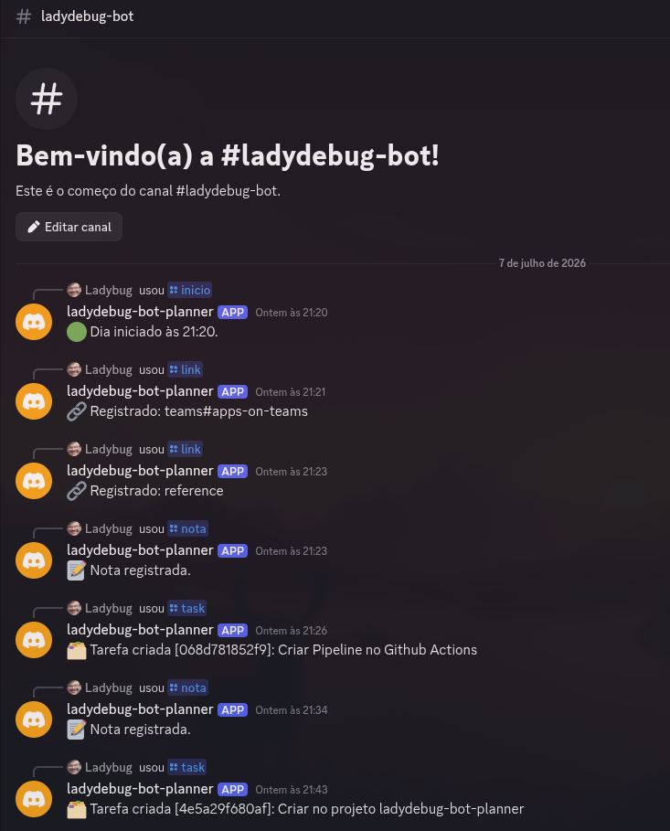
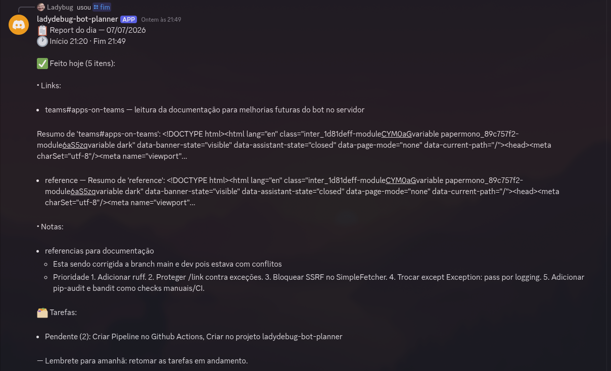
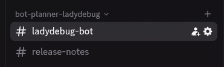
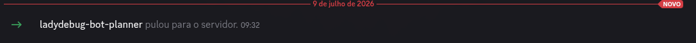
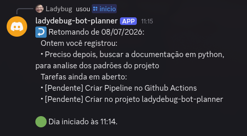
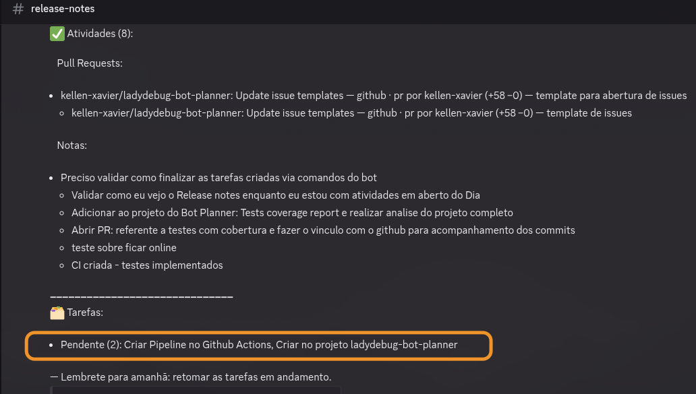

Recently I have been developing some AI study projects, and I needed a way to organize how long I spent working on them: elapsed time.

While developing something, I usually read language documentation for practices, collect document links, and write documentation for particular project features. I also remember tasks while working and notice things I can finish right after the current task. Add comments about what was done, and that is the general tracking I needed.

Based on that problem, I thought of something practical to use during development: `/inicio` when starting an activity, `/link` to add documentation and other important references, `/nota` for notes and comments, `task` to create tasks, and `fim` when finishing everything. Afterward, it should generate release notes describing completed work and pending tasks.

Then I read [a blog post](https://akitaonrails.com/2026/02/16/vibe-code-do-zero-a-producao-em-6-dias-the-m-akita-chronicles/#spoiler-do-processo) and thought of creating a personal management bot to support my development cycle with little friction and generate notes at the end of the work.

It could also be used for sharing with someone on the team, following XP-oriented development.

---

I created the repository at <https://github.com/kellen-xavier/ladydebug-bot-planner>, ~~initially private, with plans to release it afterward~~, now open source. I am fixing some security issues and first creating the bot. Initially interaction is through Discord, but it will support multiple communication channels. I mainly considered Slack and Discord; the others did not particularly interest me.

## First development phase





During initial testing, commands cluttered the unified chat. I considered creating a second text channel for separate release notes, making it easier to review the following day with a clear distinction between commands and release notes.



---

### Bot organization

Configuring the bot is straightforward. Follow the official documentation: [Building your first Discord bot](https://docs.discord.com/developers/quick-start/getting-started).



**Configuring the bot for this case study:**

1. Go to the Discord Developer Portal.
2. Open the ladydebug-bot-planner app.
3. Go to Bot.
4. Click Reset Token.
5. Copy the new token.
6. Update DISCORD_TOKEN in `.env`.
7. Run again:

   ```bash
   set -a; source .env; set +a
   python -m daily.main
   ```

8. Set up the minimum local configuration.

Your local `.env` should contain at least:

`DISCORD_TOKEN=token_do_bot
DISCORD_GUILD_ID=807481361916100628
DB_PATH=daily.db`

---

### Bot Planner test plan

Overview.

**Checklist:**

#### All items

[•] Map existing modules and features in src/daily.
[ ] Map existing tests by feature.
[ ] Run available tests and coverage.
[ ] Consolidate coverage gaps and recommendations.

### Features with tests

I created the report at docs/TEST_COVERAGE_REPORT.md, documenting:

- Current suite status: 79 passed.
- Guidelines for avoiding biased tests and false positives.
- Remaining gaps by priority.
- Exact scenarios to implement.
- Acceptance criteria for subsequent rounds.
- A recommendation to add pytest-cov.
- Suggested execution order.

**Main areas prioritized in the report:**

1. CommandRouter.
2. SqliteStorage.
3. SimpleFetcher.
4. VCS adapters.
5. End-of-day report.
6. Discord adapter callbacks.
7. Models/DTOs.
8. Objective coverage measurements.

---

**Errors encountered:**

```jsx
python -m daily.main
2026-07-09 09:32:45 INFO     discord.client logging in using static token
2026-07-09 09:32:47 INFO     discord.gateway Shard ID None has connected to Gateway (Session ID: b25a5b78274ede64c286f2fc11e8c2e3).
Bot online como ladydebug-bot-planner#3088
2026-07-09 09:51:05 ERROR    discord.app_commands.tree Ignoring exception in command 'inicio'
Traceback (most recent call last):
  File "/home/kellen/Documents/Projetos github/ladydebug-bot-planner/.venv/lib/python3.14/site-packages/discord/app_commands/commands.py", line 859, in _do_call
    return await self._callback(interaction, **params)  # type: ignore
           ^^^^^^^^^^^^^^^^^^^^^^^^^^^^^^^^^^^^^^^^^^^
  File "/home/kellen/Documents/Projetos github/ladydebug-bot-planner/src/daily/adapters/discord_bot.py", line 90, in inicio
    msg = router.inicio(str(interaction.user.id), str(interaction.channel_id))
  File "/home/kellen/Documents/Projetos github/ladydebug-bot-planner/src/daily/command_router.py", line 32, in inicio
    s = self._day.start_day(user_id, channel_id)
  File "/home/kellen/Documents/Projetos github/ladydebug-bot-planner/src/daily/core/day_service.py", line 32, in start_day
    raise DayAlreadyOpen("Já existe um dia aberto para este usuário.")
daily.core.day_service.DayAlreadyOpen: Já existe um dia aberto para este usuário.

The above exception was the direct cause of the following exception:

Traceback (most recent call last):
  File "/home/kellen/Documents/Projetos github/ladydebug-bot-planner/.venv/lib/python3.14/site-packages/discord/app_commands/tree.py", line 1302, in _call
    await command._invoke_with_namespace(interaction, namespace)
  File "/home/kellen/Documents/Projetos github/ladydebug-bot-planner/.venv/lib/python3.14/site-packages/discord/app_commands/commands.py", line 884, in _invoke_with_namespace
    return await self._do_call(interaction, transformed_values)
           ^^^^^^^^^^^^^^^^^^^^^^^^^^^^^^^^^^^^^^^^^^^^^^^^^^^^
  File "/home/kellen/Documents/Projetos github/ladydebug-bot-planner/.venv/lib/python3.14/site-packages/discord/app_commands/commands.py", line 877, in _do_call
    raise CommandInvokeError(self, e) from e
discord.app_commands.errors.CommandInvokeError: Command 'inicio' raised an exception: DayAlreadyOpen: Já existe um dia aberto para este usuário.
```

**Reason:**

DayAlreadyOpen: a day is already open for this user.
This happens because `/inicio` opened a session in daily.db, and then `/inicio` was called again without first closing it with `/fim`.

**Explanation:**

Technical cause: the core correctly prevents two days from being open:

```python
if self._storage.get_open_session(user_id) is not None:
    raise DayAlreadyOpen("Já existe um dia aberto para este usuário.")
```

The problem is that this exception reaches Discord and produces a stack trace. The bot should respond with a friendly message, such as: "You already have an open day. Use /fim to close it before starting another."

**Corrections:**

Adjustment plan: still in planning mode, so no files will be edited yet. The recommended changes are:

1. Handle DayAlreadyOpen in CommandRouter.inicio.
2. Handle NoOpenDay in `/nota`, `/link`, and `/fim`.
3. Prevent expected core exceptions from becoming Discord errors.
4. Improve Discord environment diagnostics with DISCORD_CLIENT_ID.
5. Document local and production configuration in the README.
6. Add tests for these cases.

## Expected behavior after the adjustments

Validate `/inicio` with a day already open and activities unfinished.
Expected message:

🟡 You already have an open day. Use `/continuar` to resume your day.

Behavior: submitting `/continue` should continue adding activities to the day. In other words:

**Scenario:**

Given the user sends `/iniciar` on day 1,
and sends `/iniciar` again on day 1,
when the message returns, "🟡 You already have an open day. Use `/continuar` to resume your day,"
then the user should enter `/continuar`
and continue until finishing the day.

Validate `/nota` without an open day.
Expected message: ⚠️ No open day. Use /inicio first.

Validate `/fim` without an open day.
Expected message: ⚠️ No open day to close. Use /inicio to start.

Validate `/link` without an open day.
Expected message: ⚠️ No open day. Use /inicio first.

### Files that should change

- src/daily/command_router.py
- src/daily/adapters/discord_bot.py
- src/daily/main.py
- .env.example
- [README.md](http://readme.md/)
- tests/test_ingest_and_report.py
- tests/test_discord_bot.py
- tests/test_main_config.py

**What changed:**

- src/daily/command_router.py.
- `/inicio` with an open day now returns: 🟡 You already have an open day. Use /continuar to resume your day.
- New continuar method.
- `/nota`, `/link`, and `/fim` now handle NoOpenDay with friendly messages.
- `/link` checks for an open day before fetching and summarizing a URL.
- src/daily/adapters/discord_bot.py.
- Added the Discord `/continuar` command.
- Improved diagnostics when the bot cannot see the server.
- If DISCORD_CLIENT_ID is configured, the error prints the correct invitation URL.
- src/daily/main.py.
- Added environment validation: DISCORD_TOKEN is required; DISCORD_GUILD_ID and DISCORD_CLIENT_ID must be numeric when supplied.
- .env.example.
- Added DISCORD_CLIENT_ID.
- [README.md](http://readme.md/).
- Documented `/continuar`.
- Documented local and production environments.
- Added Discord troubleshooting.
- Added tests for `/inicio` with an open day.
- Added tests for `/continuar` with and without an open day.
- Added tests for `/nota`, `/link`, and `/fim` without an open day.
- Added tests for DISCORD_CLIENT_ID and DISCORD_GUILD_ID validation.
- Added tests for the invitation URL in diagnostics.

---

### Overview of Discord tests



---

### Updates and improvements

A second text channel was added. The `/fim` command finishes the report and adds the day's release notes to the channel that made the call.

We then noticed that activities created during the day need to be completed. This leads to the next feature.

**Feature:** given that a user completes a created task, they should submit `/fim-task` with the following action.

**Expected behavior:**

URL: add the link to the completed activity.
Task title: my task's name.
Time the activity was open: xx minutes / xx hours / xx days.

Given that the activity contains a comment,
when the action is completed,
then the release notes should display the comments added to that action.



---

### Production workflow

1. Create a #release-notes channel.
2. Copy its channel ID.
3. Create an app/bot in Discord.
4. Invite the bot with bot applications.commands.
5. Create a Railway project connected to GitHub.
6. Configure secrets on Railway.
7. Configure persistent storage.
8. Start command: python -m daily.main.
9. Deploy.
10. Test in Discord:

- /inicio
- /nota
- /pr url:[https://github.com/.../pull/](https://github.com/.../pull/)...
- /fim
