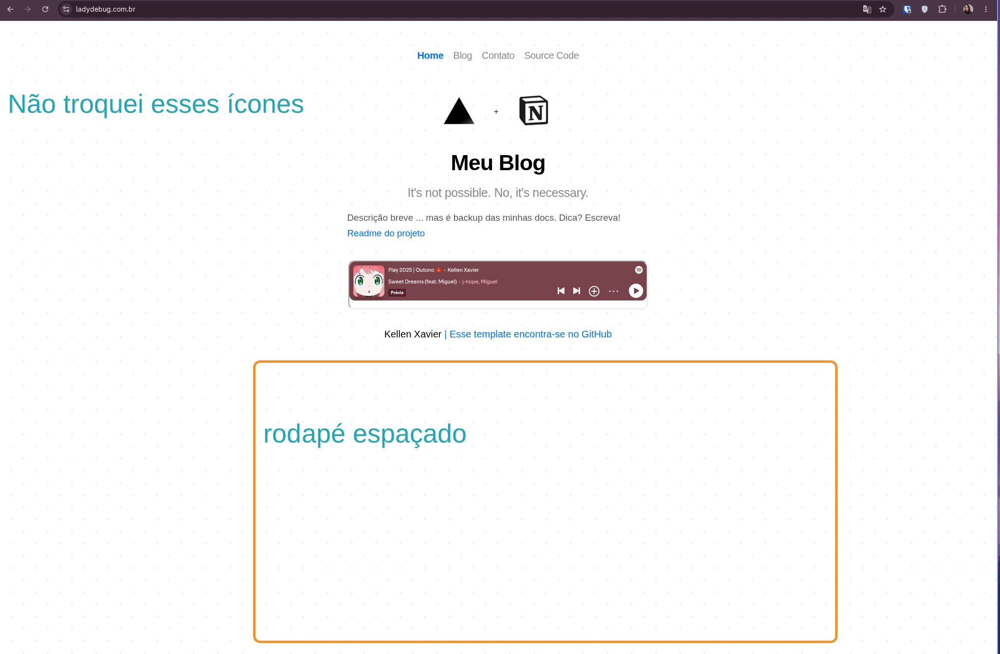
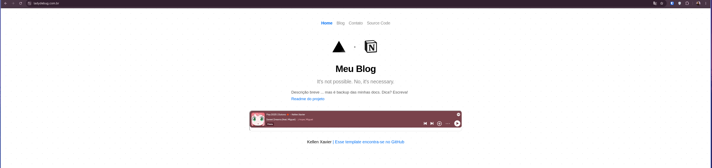

## Analysis of the notion-blog repository

My personal blog was full of bugs because I had not done the necessary maintenance since creating it, perhaps two years ago. Now the idea is to fix bugs and add features I would like.



Broken pagination, slow loading, and content centralized in one tool.

**What I want to improve:** decentralize the content, organize routine versioned backups, and deploy to dev as well as main.

---

## 1. Overview

It is a **static Next.js blog using Notion as its CMS/backend**. It is a fork of the original [`ijjk/notion-blog`](https://github.com/ijjk/notion-blog) template, customized by me. Post content lives in a Notion table, and the site is generated through **SSG, Static Site Generation**, with incremental revalidation, hosted on Vercel.

- **Current deployment:** `https://notion-blog-lake-two.vercel.app/`
- **Current branch:** `claude/repository-analysis-ieglo6`, identical to develop, with no differences.
- **License:** present, `license`.

## 2. Stack and dependencies

| Layer | Technology |
| --- | --- |
| Framework | Next.js `^11.1.2`, Pages Router |
| UI | React `17`, CSS Modules |
| Language | TypeScript `5.8`, with `strict: false` |
| Content | **Unofficial private Notion API**, `www.notion.so/api/v3` |
| Extras | `katex`, equations; `prismjs`, syntax highlighting; `@zeit/react-jsx-parser`; `async-sema`, rate limiting; `github-slugger` |
| Quality | Prettier, lint-staged, pre-commit |
| Deployment | Vercel |

## 3. Structure

```text
src/
├── pages/
│   ├── index.tsx          # Home
│   ├── contact.tsx        # Contato (GitHub/LinkedIn)
│   ├── blog/index.tsx     # Lista de posts (getStaticProps)
│   ├── blog/[slug].tsx    # Renderiza 1 post (getStaticProps/Paths + fallback)
│   └── api/               # asset.ts, preview.ts, preview-post.ts, clear-preview.ts
├── lib/notion/            # Integração com o Notion (rpc, getBlogIndex, getPageData…)
├── lib/build-rss.ts       # Gera feed Atom em /public/atom no build
├── components/            # Header, Footer, Code, Equation, Counter, SVGs, SpotifyPlayer…
└── styles/                # CSS Modules + global.css
scripts/create-table.js    # Cria a tabela-modelo no Notion via API privada
```

## 4. How it works — Data flow

1. **`rpc.ts`** sends authenticated POST requests to Notion's private endpoint using the `token_v2=$NOTION_TOKEN` cookie.
2. **`getBlogIndex`** loads the table, `BLOG_INDEX_ID`, builds the post map through `getTableData`, which interprets the Notion collection schema, and fetches previews for the 10 most recent posts with concurrency limited to three through `async-sema`. It uses disk caching, `.blog_index_data*`, during builds, `USE_CACHE`.
3. **`blog/index.tsx`** filters drafts in production, `Published === 'Yes'`, and lists posts.
4. **`blog/[slug].tsx`** retrieves post content through `getPageData` and paginated `loadPageChunk`, resolves tweet embeds, and uses a large switch to convert each Notion block type into JSX: text, header, image, code, quote, callout, equation, bookmark, tweet, and others.
5. **`api/asset.ts`** acts as a proxy: it retrieves the signed Notion file URL with `getSignedFileUrls`, then redirects with status 307 to serve images and videos.
6. **`build-rss.ts`** runs at build time and generates the Atom feed at `/public/atom`.
7. **Preview mode:** `api/preview.ts` and `preview-post.ts` enable Next's draft mode.

## 5. Strengths

- A lean architecture with clear separation between lib, pages, and components.
- Correct use of SSG with `revalidate`, ISR, and `fallback: true`.
- Preview-fetch rate limiting and build caching.
- Rich Notion block support: KaTeX equations, Prism code, callouts, bookmarks, videos, tweets.
- Formatting tools: Prettier and lint-staged.

## 6. Problems and risks I found

### Security and practical concerns

- **`NOTION_TOKEN` used as the preview password:** `preview.ts` and `preview-post.ts` compare `req.query.token === process.env.NOTION_TOKEN`. This puts the **secret Notion token in the URL**, exposing it to logs, history, and referrers. A separate secret such as `NEXT_PREVIEW_SECRET` should be used.
- **Private Notion API**, `token_v2` and `/api/v3`: unofficial, potentially subject to breaking changes, and the token is your personal session. The preferred approach is migration to the **official Notion API**, `@notionhq/client`.
- **`api/asset.ts` is an open proxy**, `Access-Control-Allow-Origin: *`, signing URLs for any supplied `assetUrl` or `blockId`. It is worth restricting.

### Undeclared dependencies

- `node-fetch`, `@next/env`, and `shell-quote` are **imported but absent from package.json**, working only through transitive dependencies or hoisting. This is fragile and can break builds with a clean lockfile. They should be explicit dependencies.

### Leftovers from the original template and inconsistent branding

- `header.tsx`: the Source Code link and OG image point to `ijjk/notion-blog` and `notion-blog.now.sh`, whose now.sh domain is disabled; Twitter points to `@_ijjk`.
- `footer.tsx`: links to ijjk's repository.
- `index.tsx`: still uses the Vercel + Notion image and branding.
- Generic metadata and `<title>`, such as My Notion Blog and An example Next.js site…
- **Mixed Portuguese and English** in the interface.

### Potentially broken or fragile code

- **Tweet embeds** use `api.twitter.com/1/statuses/oembed.json`, the discontinued v1 API, and probably no longer work.
- `[slug].tsx` uses `unstable_revalidate`, an old API ignored in Next 11, alongside `revalidate`.
- `equation.tsx`: `render()` can return `undefined` if an error is not a `ParseError`, because `result` is never assigned.
- `getPageData` removes table blocks with a fixed `splice(0, 3)`, which is brittle.
- **Inconsistent Node versions:** the README asks for Node `>=18`, but `getBlogIndex.ts` uses `Array.prototype.toSorted()`, requiring **Node 20+**. Meanwhile, `vercel.json` forces `-openssl-legacy-provider` as a workaround for old builds. I recommend explicitly fixing Node 20.

### Quality and maintenance

- `tsconfig` uses `strict: false`, reducing type safety, with many uses of `any`.
- **No tests or CI**, with `.github/` absent.
- Small README errors, such as using `´´´` instead of Markdown code fences.

## 7. Prioritized recommendations

1. **Replace the preview secret** with a dedicated variable, avoiding `NOTION_TOKEN` in the URL.
2. **Declare `node-fetch`, `@next/env`, and `shell-quote`** in package.json.
3. **Update branding:** links, OG image, title, and Twitter should use mine, removing ijjk and now.sh leftovers.
4. **Fix or remove tweet embeds**, the dead v1 API, and `unstable_revalidate`.
5. **Align the Node version**, fixing `engines: node >=20` because of `toSorted()`.
6. In the medium term, **migrate to the official Notion API** and consider upgrading Next.js from version 11 for security and performance.

---

## Blog fixes



First I requested an analysis through claude.ai, then wrote the following instructions:

> 📚 claude/repository-analysis-ieglo6? I can start with low-risk, high-impact changes: package.json dependencies, branding, the preview secret, and small bugs. Since this was an analysis task, I have not made changes yet.
>
> Implement as follows.
>
> - Fix the issues and always run the necessary tests. Do not implement without testing.
> - Open PRs after validation tests.
> - Handle sensitive updates carefully to avoid breaking production.
> - Document changes only in my kellen-xavier repository.
> - Create /docs for documentation.
> - Do not share keys or sensitive data, including in documentation or README.md.
> - Create an .agents setup for persistent information.
> - Include .AGENTS.md in the setup.
>
> Pay attention and test at every step.

| Stage | Change | Validation |
| --- | --- | --- |
| **Dependencies** | Declared `node-fetch@2.6.1`, `@next/env@11.1.2`, `shell-quote@1.7.2` as dev, and `@types/node-fetch`; added `engines.node >=20` and typecheck/test scripts | Passing tsc |
| **Security, sensitive** | Dedicated `PREVIEW_TOKEN` in [`src/lib/preview-auth.ts`](https://github.com/kellen-xavier/notion-blog/blob/claude/repository-analysis-ieglo6/src/lib/preview-auth.ts), **with fallback** to `NOTION_TOKEN` to avoid breaking production | Four tests: 401, 404, success, fallback |
| **Branding** | Removed ijjk and now.sh leftovers from header, footer, and server constants | Regression test |
| **Bugs** | `equation.render` never returns undefined; `unstable_revalidate` replaced by `revalidate`; dead v1 tweet oEmbed replaced by `publish.twitter.com` | Render test and build |
| **Docs** | /docs with SETUP, ARCHITECTURE, SECURITY, CHANGELOG, only in my repository | — |
| **Agents** | AGENTS.md in the root and .agents/ for persistent context and conventions | — |

- For `.AGENTS.md`, with a leading dot, I used the standard `AGENTS.md` convention at the root, the name agent tools recognize, plus an `.agents/` folder for persistent setup.
- The PR targeted **develop**, the repository's default branch, in four thematic commits.
