## Testando um jogo existente na Unreal: objetivos e portal no Stack O Bot

Setting up test Environment - S.O Linux Omarchy (Arch Linux Config) | Unreal Engine

Resolvi, refazer um dos testes que havia trabalhado a cerca de três/dois anos atrás (2023/2024) em um trabalho que era QA em Games (Simulador). 

Preparando meu setup para validações de um game pronto, da Epic Games, para o computador. Primeiro meu setup atual é o Omarchy Linux (based no arch linux - [página do S.O aqui](https://omarchy.org/)) fui verificar no GPT como estava as bibliotecas e drives (se tem suporte oficial da Unreal e afins) sem baixar drives sem updates ou maliciosos. Foi recomendado as seguinte dependências úteis.

```bash
sudo pacman -S --needed \
  fuse2 \
  vulkan-tools \
  unzip \
  git \
  clang \
  cmake \
  ninja
```

Para verificar Vulkan:

```bash
vulkaninfo --summary
```

### Retornos dos comandos


Como minha placa de vídeo é da NVIDIA precisei conferir os drives dela (NVIDIA geralmente é a que menos tem compatibilidade com o Linux)

```bash
nvidia-smi
```

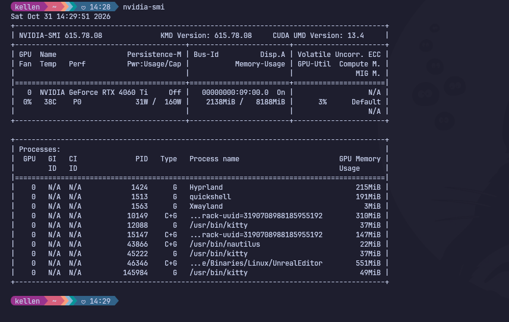

- placa de vídeo com compatibilidade = ok

Por recomendações instalei o Epic Games Launcher nativo [Download realizado por aqui](https://launcher.epicgames.com/) seguindo para a Intalação: Dar permissão para o install

```bash
chmod +x EpicGamesLauncher*.AppImage
```

Fazer o Install:

```bash
./EpicGamesLauncher*.AppImage

# Extraia para uma pasta própria:
unzip Linux_Unreal_Engine*.zip \
  -d ~/Applications/UnrealEngine/UE_5.8
  
# go in
cd ~/Applications/UnrealEngine/UE_5.8

# error permission - run before
chmod +x Engine/Binaries/Linux/UnrealEditor

# run
./Engine/Binaries/Linux/UnrealEditor

```

### Flow

Epic Games Launcher
↓
Unreal Engine
↓
Library
↓
Engine Versions
↓
+
↓
selecionar versão
↓
Install

[Com base nos requisitos recomendados:](https://dev.epicgames.com/documentation/unreal-engine/linux-development-requirements-for-unreal-engine](https://dev.epicgames.com/documentation/unreal-engine/linux-development-requirements-for-unreal-engine?lang=pt-BR)

Esta dentro do recomendado.

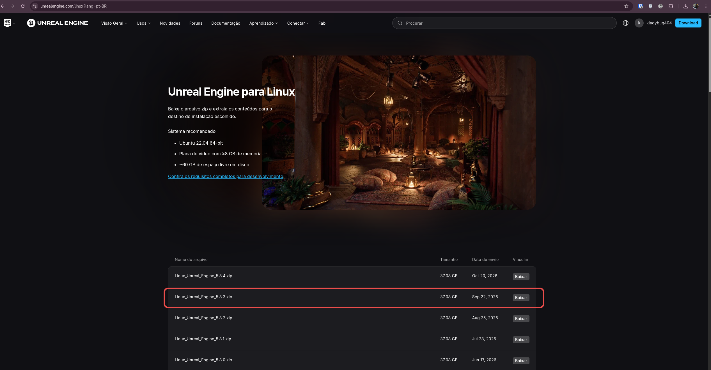

Omarchy setup

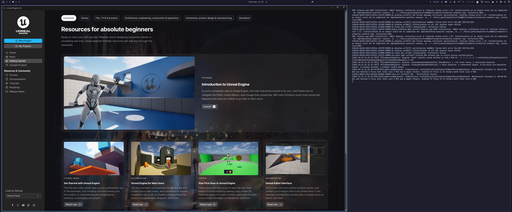

## Pesquisa de Jogo para Testes

**Recomendação na pesquisa**: O Lyra é um projeto gratuito de referência que inclui código C++, Blueprints, personagens, armas, regras de gameplay, interface, recursos multiplayer e uma arquitetura modular. Ele é particularmente adequado para estudar Engenharia de Software aplicada a games, porque permite investigar os sistemas individualmente e testar suas integrações.

Quais camadas você consegue testar no Lyra?

| Camada de teste | Exemplos de cenários |
| --- | --- |
| Unidade | Cálculo de dano, atributos, cooldowns e validação de estados |
| Componente | Habilidades, inventário de armas e componentes de gameplay |
| Integração | Personagem + arma + sistema de habilidades |
| Funcional | Jogador atira, causa dano e elimina outro personagem |
| E2E | Iniciar jogo, entrar em partida, jogar e encerrar sessão |
| Multiplayer | Replicação de estado, sincronização e autoridade do servidor |
| Performance | FPS, frame time, consumo de memória e carregamento |
| Regressão | Validar mecânicas após alterações no código |

Em particular este jogo bastante pontos que é possível validar, seguindo o tutorial para o Install do jogo segue.

**Para instalar:**

1. Abra a página do Lyra no Fab e faça login na conta Epic.
2. Selecione Add to My Library.
3. No Epic Games Launcher, acesse Unreal Engine → Library → Fab Library.
4. Localize Lyra Starter Game e selecione Create Project.
5. Selecione uma versão compatível com sua instalação da Unreal.

Unreal Engine Open

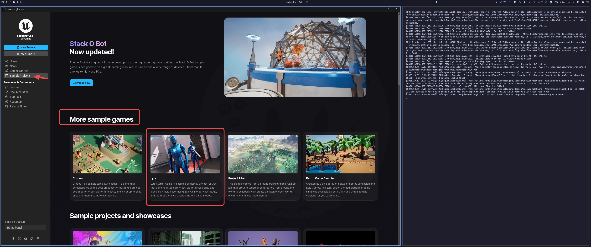

Game adicionado a biblioteca

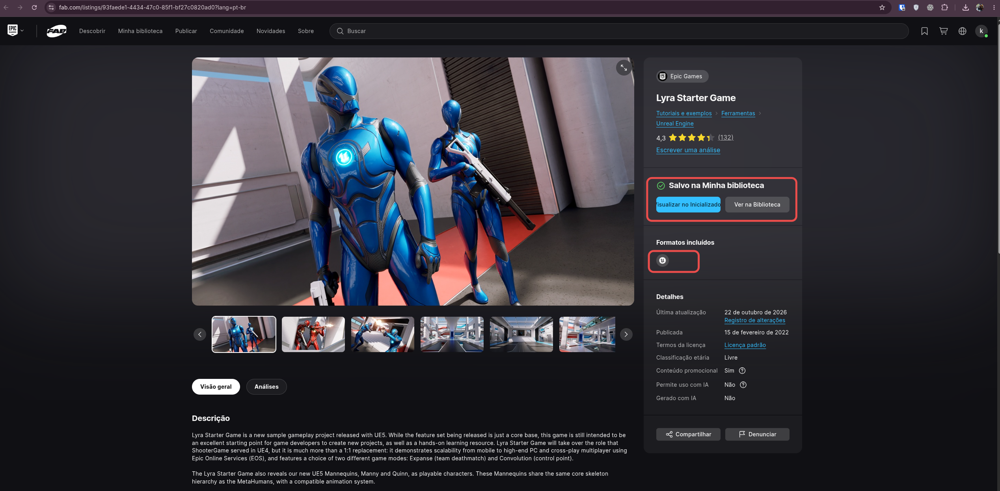

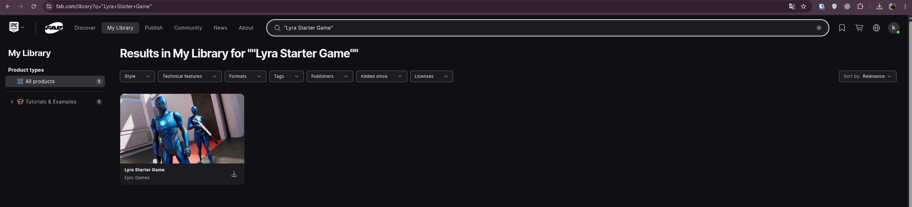

Login conta Epic

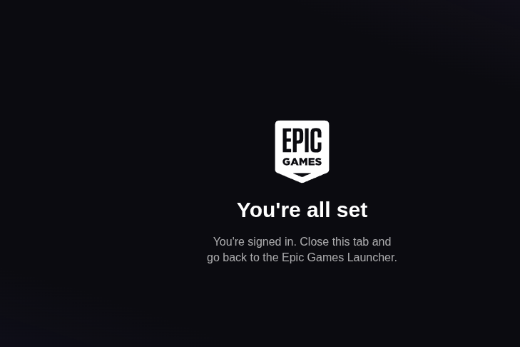

Selecionar o game para abrir o projeto

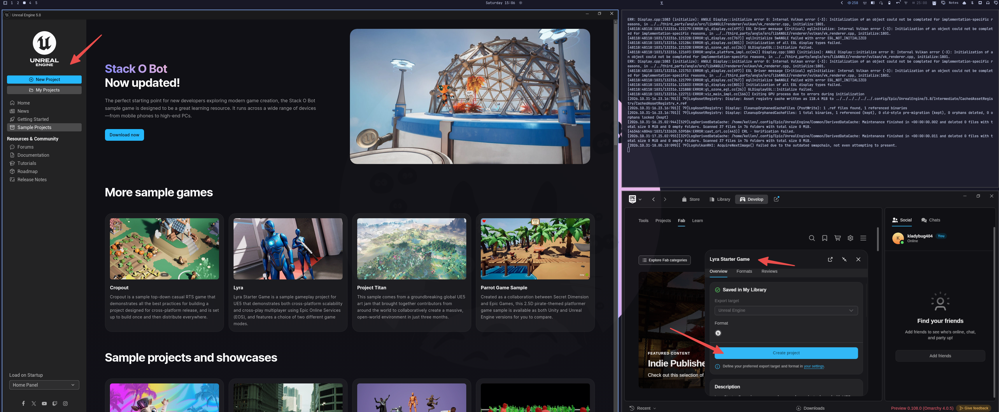

Selecionando pasta do projeto para criar

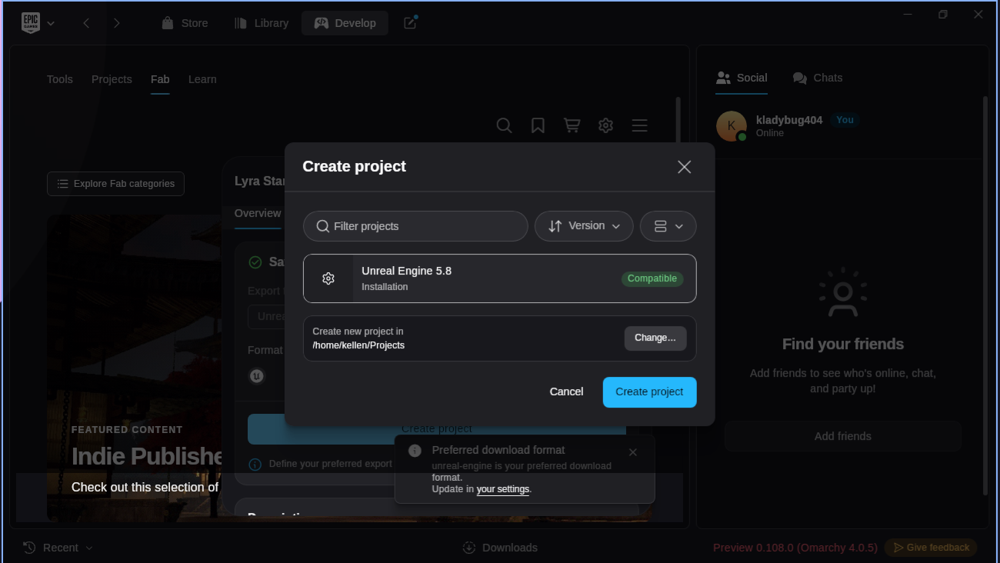

Download

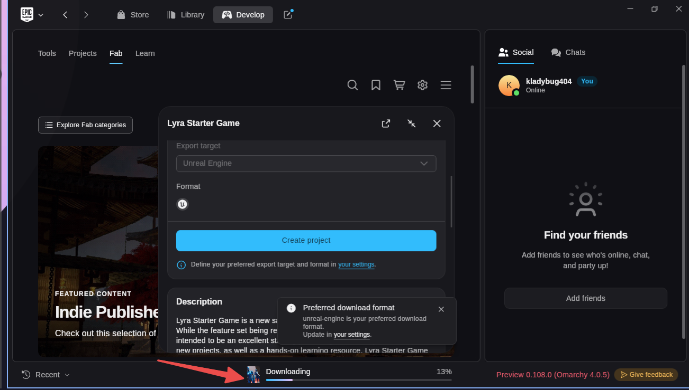

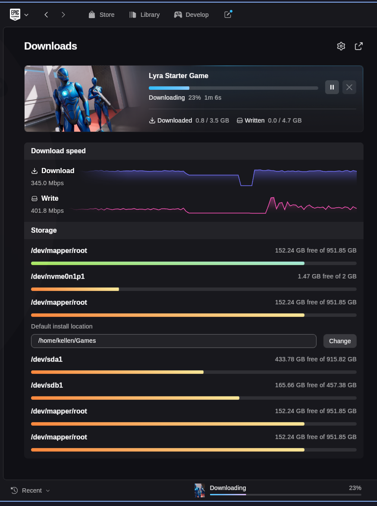

---

### Erro ao baixar jogo Lyra

Tentei realizar o download mas não foi possível.

O log mostra que o link assinado já estava inválido quando o Launcher tentou usá-lo:

- Em **2/11, às 12:16:27 (-03)**, a instalação chegou ao manifesto `Lyra_5.3` e recebeu **HTTP 410** cerca de **0,1 segundo** após iniciar a requisição.
- Às **12:20:12**, uma nova tentativa recebeu outro **410** em cerca de **0,04 segundo**, desta vez já no manifesto `Lyra_5.0`.
- Em **31/10**, houve falha semelhante, com **HTTP 403** e a mesma indicação de link assinado expirado.

Isso torna improvável que o link tenha expirado **por causa da duração do download (ou algum problema de internet)**. O padrão sugere que o fluxo do Fab/Launcher estava entregando ou reutilizando links que **já estavam vencidos**. **Os logs não permitem determinar se a origem foi o serviço do Epic/Fab ou a renovação dos links no Launcher Linux.** O HTTP 410 indica que o recurso deixou de estar disponível; a documentação do Fab confirma que os produtos para Unreal Engine são baixados pela integração com o Fab/Launcher, mas não informa o prazo de validade desses links.

[Link RFC 9110]([https://www.rfc-editor.org/rfc/rfc9110.html](https://www.rfc-editor.org/rfc/rfc9110.html))

[Documentação Fab]([https://dev.epicgames.com/documentation/fab/purchasing-and-downloading-assets-in-fab](https://dev.epicgames.com/documentation/fab/purchasing-and-downloading-assets-in-fab))

Para começar seu projeto agora, recomendo criar um projeto **Third Person** no Unreal 5.8. O template já vem com personagem jogável e nível básico, sem precisar baixar outro pacote do Fab. [A documentação da Epic explica como criar o projeto](https://dev.epicgames.com/documentation/unreal-engine/create-your-first-project-in-unreal-engine).

Se você prefere um sample de jogo para baixar, a alternativa é **Stack O’ Bot**, que a Epic descreve como um projeto pequeno e ponto de partida para quem já conhece o básico. Ele também é distribuído pelo Fab, então pode encontrar a mesma falha de link no launcher. [Página oficial de samples da Epic](https://www.unrealengine.com/download).

---

## Escolhendo outro jogo e Abrindo no Editor

Escolhi este jogo mas também precisei organizar o projeto na pasta para que fique dentro Unreal Projects

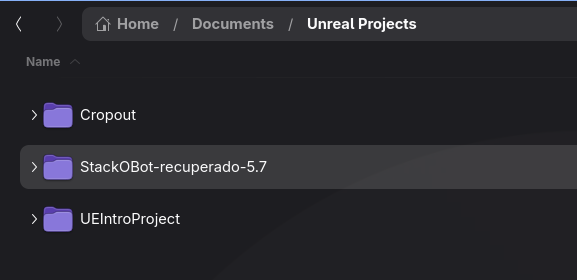

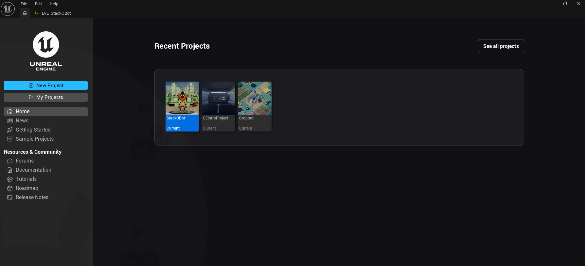

Clica no jogo para abrir e segue, pode adicionar o plugin de testes

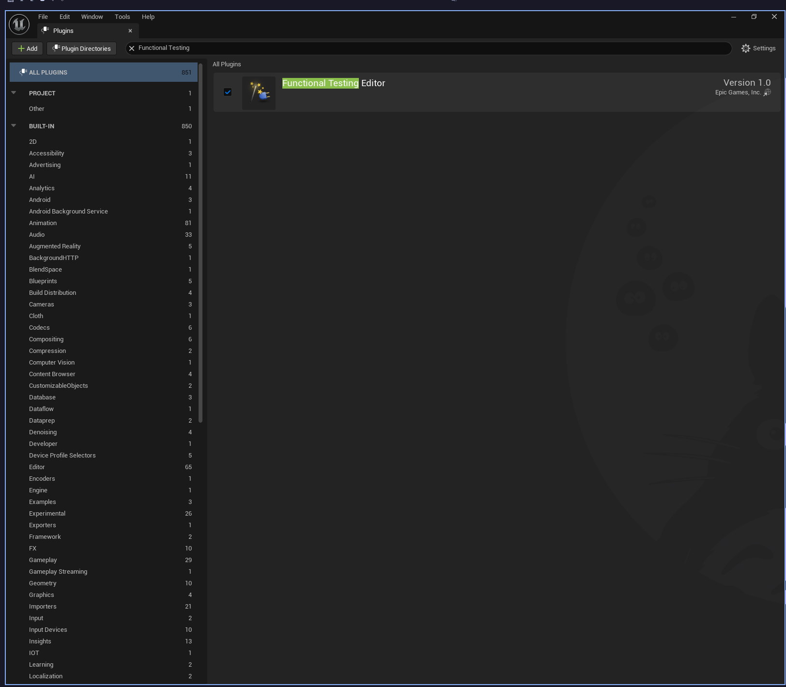


---

### References

**Test Gameplay:** [https://dev.epicgames.com/community/learning/tutorials/DB1x/unreal-engine-gameplay](https://dev.epicgames.com/community/learning/tutorials/DB1x/unreal-engine-gameplay)
