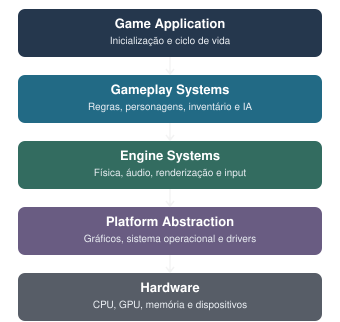
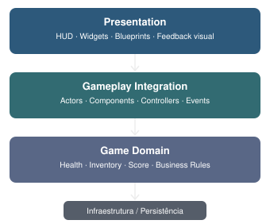
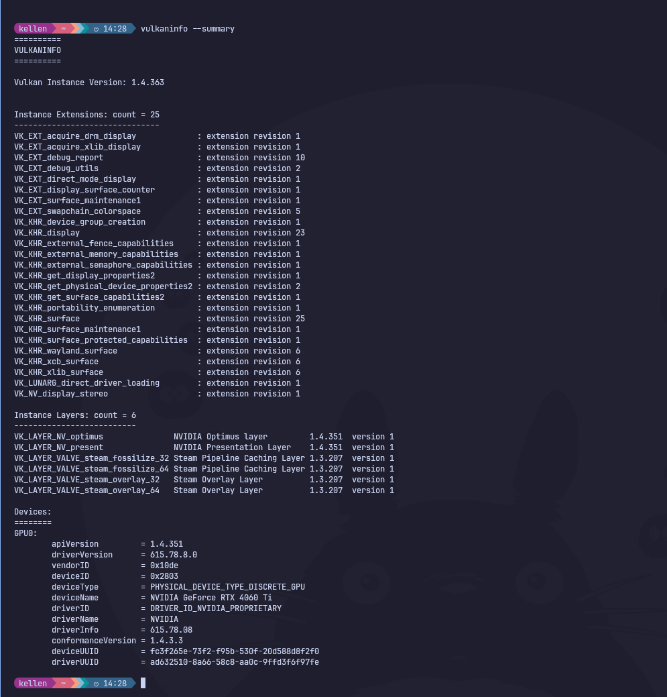

## Um pouco sobre Jogos, arquitetura e Testes

A arquitetura de jogos digitais combina princípios tradicionais da Engenharia de Software com necessidades específicas de sistemas interativos em tempo real: renderização, simulação física, processamento de entradas, inteligência artificial, gerenciamento de estados e execução contínua de um ciclo de atualização (Game Loop).

Na Unreal Engine 5.8.3, que eu instalei no sistema operacional, Omarchy, é possível desenvolver e testar esses sistemas utilizando C++, Blueprints e os frameworks de automação fornecidos pela própria Epic Games entre outros.

Fui pesquisar um pouco sobre então, como é a arquitetura de um Jogo

## 1. Como funciona a arquitetura de um jogo

Uma arquitetura de jogo não é simplesmente uma organização de arquivos. Ela define como as responsabilidades são distribuídas, como os componentes se comunicam e como o estado do jogo evolui a cada atualização.



Essas camadas podem ser compreendidas da seguinte forma:

| Camada | Responsabilidade |
| --- | --- |
| Game Application | Inicialização, carregamento, encerramento e configuração |
| Gameplay | Regras do jogo, combate, pontuação, progressão e interações |
| Engine | Renderização, física, animação, áudio e gerenciamento de objetos |
| Plataforma | Integração com Linux, Windows, gráficos e dispositivos |
| Hardware | Execução na CPU, GPU, memória e periféricos |

A Unreal Engine já implementa grande parte da infraestrutura. O trabalho do desenvolvedor costuma concentrar-se nos sistemas de gameplay, conteúdo e integrações.

### 1.1. O Game Loop

Diferentemente de muitos sistemas web, os jogos executam um ciclo contínuo que atualiza a simulação e produz quadros na tela.

Exemplos:

**Um ciclo típico envolve:**

1. Capturar entradas de teclado, mouse ou controle.
2. Atualizar estado e regras de gameplay.
3. Executar ou consultar a simulação física.
4. Produzir as informações necessárias para renderização.
5. Apresentar o quadro e continuar a execução.

## 2. A arquitetura específica da Unreal Engine

A Unreal utiliza um framework de gameplay orientado a objetos, com composição de componentes e classes que possuem ciclos de vida específicos.

### Gameplay Framework

Define classes-base para entidades, controladores, estado da sessão e representação do jogador. Inclui `Actor`, `Pawn`, `Character`, `GameMode`, `GameState` e `PlayerController`.

### Blueprints

Sistema visual de programação utilizado para criar comportamentos, protótipos, lógica de gameplay e integração com classes C++.

### Levels e Assets

Os níveis representam ambientes do jogo. Os assets incluem materiais, texturas, animações, Blueprints e outros conteúdos.

Exemplos práticos:

### Principais classes da Unreal

| Classe | Responsabilidade |
| --- | --- |
| `UGameInstance` | Estado e serviços que persistem entre carregamentos de níveis |
| `AGameModeBase` | Define regras e configuração de uma sessão; no multiplayer, existe no servidor |
| `AGameStateBase` | Representa estado compartilhado da partida |
| `APlayerController` | Recebe e coordena comandos do jogador |
| `APawn` | Entidade controlável por jogador ou IA |
| `ACharacter` | Pawn especializado para personagens, com suporte a movimentação |
| `AActor` | Entidade que pode existir em um mundo |
| `UActorComponent` | Funcionalidade reutilizável associada a um Actor |

[Fonte: gameplay framework in unreal engine](https://dev.epicgames.com/documentation/unreal-engine/gameplay-framework-in-unreal-engine?lang=pt-BR)

Um exemplo simples: o jogador pressiona um botão, o `PlayerController` processa a entrada, o `Character` executa uma ação e um componente de saúde atualiza o estado do personagem.

### Organização interna do código

Uma organização por funcionalidade é adequada para um projeto de médio porte:

```text
Source/
└── GameEngineeringLab/
├── GameEngineeringLab.Build.cs
├── Public/
│   ├── Characters/
│   ├── Combat/
│   ├── Inventory/
│   └── Systems/
└── Private/
├── Characters/
├── Combat/
├── Inventory/
├── Systems/
└── Tests/
├── Unit/
└── Integration/
```

O papel de `Public` e `Private` está relacionado à exposição e implementação de código C++ dentro do sistema de módulos da Unreal. Não é necessário colocar todas as classes em `Public`: classes utilizadas apenas internamente podem permanecer em `Private`.

Para projetos maiores, é possível criar módulos separados como `GameCore`, `GameRuntime` e `GameTests`, ou plugins próprios.

Comparação com outros projetos de software, veja abaixo exemplos:

| Aplicações tradicionais | Desenvolvimento de games |
| --- | --- |
| Entidades e modelos de domínio | Objetos de gameplay, Actors e componentes |
| Serviços e casos de uso | Sistemas de gameplay |
| Controladores de requisição | Controllers de jogador, em sentido diferente |
| Banco de dados | Estado persistido, SaveGame ou serviços externos |
| Interface web | HUD, widgets e menus |
| Processamento de eventos | Eventos, inputs e atualizações do mundo |
| Testes de integração | Testes entre sistemas de gameplay |
| Testes E2E | Simulação de fluxos completos no jogo |

> A correspondência é conceitual, não uma equivalência de classes. Por exemplo, o PlayerController da Unreal não desempenha a mesma função de um controller HTTP em uma aplicação ASP.NET.

## 3. Estrutura típica de um projeto de game

Um projeto Unreal geralmente tem três grandes categorias de arquivos: código-fonte, assets e configuração. Outros diretórios são gerados automaticamente por compilação, cache e execução.

A estrutura abaixo combina os diretórios oficiais da Unreal com uma organização modular que proponho para um projeto de estudo.

A documentação oficial confirma que `Source/` contém código-fonte, `Content/` armazena assets e `Config/` define configurações. `Intermediate/` e `Saved/` contêm dados reconstruíveis, enquanto `Binaries/` guarda executáveis e outros artefatos compilados.

[Fonte: Unreal Engine Directory and Structure](https://dev.epicgames.com/documentation/unreal-engine/unreal-engine-directory-structure)

A separação entre responsabilidades facilita a criação de testes, especialmente quando as regras de negócio do jogo não dependem diretamente de animações, renderização ou elementos visuais.

[Automation Test Framework:](https://dev.epicgames.com/documentation/unreal-engine/automation-test-framework-in-unreal-engine)

**No Unreal Editor 5.8:**

1. Abra `Edit > Plugins` e procure a categoria Testing.
2. Habilite Functional Testing Editor para trabalhar com testes funcionais.
3. Reinicie o editor, caso solicitado.
4. Acesse `Tools > Test Automation`.
5. Selecione os testes disponíveis e execute com Start Tests.

O framework de automação C++ **não exige que todos os plugins de teste estejam habilitados**. A ativação de plugins específicos depende do tipo de teste.

## Como organizar uma arquitetura de jogos testável

Para evoluir o laboratório, proponho uma separação entre regras de domínio, integração com a Unreal e apresentação.



Essa separação permite utilizar testes de diferentes níveis sem duplicar responsabilidades.

| Nível de teste | Exemplo | Dependência da engine |
| --- | --- | --- |
| Unitário | Cálculo de dano | Nenhuma ou mínima |
| Integração | HealthComponent + Character | Sim |
| Funcional | Personagem recebe dano em um mapa | Sim |
| E2E | Jogador inicia, interage e conclui objetivo | Sim, jogo em execução |
| Performance | Verificar tempo de quadro e consumo de recursos | Sim |

Um detalhe importante: testes unitários de lógica pura e testes funcionais de gameplay não precisam utilizar o mesmo mecanismo de execução. A própria Epic distingue o Automation Framework dos Low-Level Tests, que são mais apropriados para isolamento de baixo nível.

## Referencias

As referências oficiais mais úteis para esse estudo são:

- Unreal Engine — Gameplay Framework: fundamentos arquiteturais de Actors, Controllers e estados.
- Unreal Engine — Directory Structure: organização de projetos, módulos e arquivos.
- Unreal Engine — Automation Test Framework: estrutura e tipos de testes automatizados.
- Unreal Engine — Functional Testing: testes funcionais executados em Levels.
- Game Programming Patterns — Robert Nystrom: padrões como Game Loop, Component, Event Queue e State. Disponível em gameprogrammingpatterns.com.
- Game Engine Architecture — Jason Gregory: arquitetura interna de motores de jogos, subsistemas e gerenciamento de recursos.

---

## Testando um jogo existente na Unreal: objetivos e portal no Stack O Bot

Setting up test Environment - S.O Linux Omarchy (Arch Linux Config) | Unreal Engine

Resolvi, refazer um dos testes que havia trabalhado a cerca de três/dois anos atrás (2023/2024) em um trabalho que era QA em Games (Simulador).

Preparando meu setup para validações de um game pronto, da Epic Games, para o computador. Primeiro meu setup atual é o Omarchy Linux (based no arch linux - [página do S.O aqui](https://omarchy.org/)) fui verificar no GPT como estava as bibliotecas e drives (se tem suporte oficial da Unreal e afins) sem baixar drives sem updates ou maliciosos. Foi recomendado as seguinte dependências úteis.

```bash
sudo pacman -S --needed \
  fuse2 \
  vulkan-tools \
  unzip \
  git \
  clang \
  cmake \
  ninja
```

Para verificar Vulkan:

```bash
vulkaninfo --summary
```

### Retornos dos comandos



Como minha placa de vídeo é da NVIDIA precisei conferir os drives dela (NVIDIA geralmente é a que menos tem compatibilidade com o Linux)

```bash
nvidia-smi
```


- placa de vídeo com compatibilidade = ok

Por recomendações instalei o Epic Games Launcher nativo [Download realizado por aqui](https://launcher.epicgames.com/) seguindo para a Intalação: Dar permissão para o install

```bash
chmod +x EpicGamesLauncher*.AppImage
```

Fazer o Install:

```bash
./EpicGamesLauncher*.AppImage

# Extraia para uma pasta própria:
unzip Linux_Unreal_Engine*.zip \
  -d ~/Applications/UnrealEngine/UE_5.8

# go in
cd ~/Applications/UnrealEngine/UE_5.8

# error permission - run before
chmod +x Engine/Binaries/Linux/UnrealEditor

# run
./Engine/Binaries/Linux/UnrealEditor
```

### Flow

```text
Epic Games Launcher
↓
Unreal Engine
↓
Library
↓
Engine Versions
↓
+
↓
selecionar versão
↓
Install
```

[Com base nos requisitos recomendados](https://dev.epicgames.com/documentation/unreal-engine/linux-development-requirements-for-unreal-engine?lang=pt-BR)

Esta dentro do recomendado.


Omarchy setup


## Pesquisa de Jogo para Testes

**Recomendação na pesquisa**: O Lyra é um projeto gratuito de referência que inclui código C++, Blueprints, personagens, armas, regras de gameplay, interface, recursos multiplayer e uma arquitetura modular. Ele é particularmente adequado para estudar Engenharia de Software aplicada a games, porque permite investigar os sistemas individualmente e testar suas integrações.

Quais camadas você consegue testar no Lyra?

| Camada de teste | Exemplos de cenários |
| --- | --- |
| Unidade | Cálculo de dano, atributos, cooldowns e validação de estados |
| Componente | Habilidades, inventário de armas e componentes de gameplay |
| Integração | Personagem + arma + sistema de habilidades |
| Funcional | Jogador atira, causa dano e elimina outro personagem |
| E2E | Iniciar jogo, entrar em partida, jogar e encerrar sessão |
| Multiplayer | Replicação de estado, sincronização e autoridade do servidor |
| Performance | FPS, frame time, consumo de memória e carregamento |
| Regressão | Validar mecânicas após alterações no código |

Em particular este jogo bastante pontos que é possível validar, seguindo o tutorial para o Install do jogo segue.

**Para instalar:**

1. Abra a página do Lyra no Fab e faça login na conta Epic.
2. Selecione Add to My Library.
3. No Epic Games Launcher, acesse Unreal Engine → Library → Fab Library.
4. Localize Lyra Starter Game e selecione Create Project.
5. Selecione uma versão compatível com sua instalação da Unreal.

Unreal Engine Open


Game adicionado a biblioteca


Login conta Epic


Selecionar o game para abrir o projeto


Selecionando pasta do projeto para criar


Download


---

### Erro ao baixar jogo Lyra

Tentei realizar o download mas não foi possível.

O log mostra que o link assinado já estava inválido quando o Launcher tentou usá-lo:

- Em **2/11, às 12:16:27 (-03)**, a instalação chegou ao manifesto `Lyra_5.3` e recebeu **HTTP 410** cerca de **0,1 segundo** após iniciar a requisição.
- Às **12:20:12**, uma nova tentativa recebeu outro **410** em cerca de **0,04 segundo**, desta vez já no manifesto `Lyra_5.0`.
- Em **31/10**, houve falha semelhante, com **HTTP 403** e a mesma indicação de link assinado expirado.

Isso torna improvável que o link tenha expirado **por causa da duração do download (ou algum problema de internet)**. O padrão sugere que o fluxo do Fab/Launcher estava entregando ou reutilizando links que **já estavam vencidos**. **Os logs não permitem determinar se a origem foi o serviço do Epic/Fab ou a renovação dos links no Launcher Linux.** O HTTP 410 indica que o recurso deixou de estar disponível; a documentação do Fab confirma que os produtos para Unreal Engine são baixados pela integração com o Fab/Launcher, mas não informa o prazo de validade desses links.

[Link RFC 9110](https://www.rfc-editor.org/rfc/rfc9110.html)

[Documentação Fab](https://dev.epicgames.com/documentation/fab/purchasing-and-downloading-assets-in-fab)

Para começar seu projeto agora, recomendo criar um projeto **Third Person** no Unreal 5.8. O template já vem com personagem jogável e nível básico, sem precisar baixar outro pacote do Fab. [A documentação da Epic explica como criar o projeto](https://dev.epicgames.com/documentation/unreal-engine/create-your-first-project-in-unreal-engine).

Se você prefere um sample de jogo para baixar, a alternativa é **Stack O’ Bot**, que a Epic descreve como um projeto pequeno e ponto de partida para quem já conhece o básico. Ele também é distribuído pelo Fab, então pode encontrar a mesma falha de link no launcher. [Página oficial de samples da Epic](https://www.unrealengine.com/download).

---

## Escolhendo outro jogo e Abrindo no Editor

Escolhi este jogo mas também precisei organizar o projeto na pasta para que fique dentro Unreal Projects


Clica no jogo para abrir e segue, pode adicionar o plugin de testes


---

### References

**Test Gameplay:** [https://dev.epicgames.com/community/learning/tutorials/DB1x/unreal-engine-gameplay](https://dev.epicgames.com/community/learning/tutorials/DB1x/unreal-engine-gameplay)
