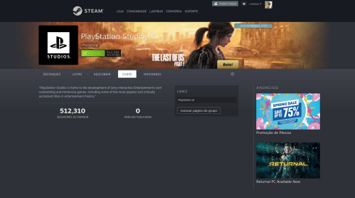
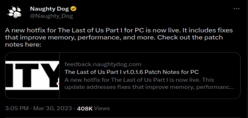
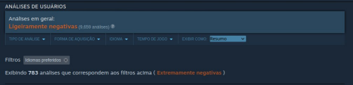
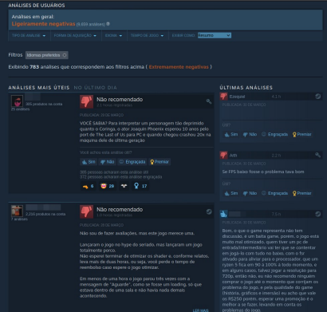

Exemplos simples mas cruciais de testes no seu projeto;

Faz muito tempo que jogos de computadores vem crescendo consideravelmente e os setups gamers ganhando cada vez mais espaço, competindo atualmente forte (e até ultrapassando) consoles de videogames no quesito potência, performance e claro, poder configurar a própria máquina com os requisitos desde entrada até hardwares de última geração, podendo decidir qual a melhor máquina no atual momento a pessoa quer. Melhorias nos componentes e peças de computadores, exemplos – CPU, Placa-Mãe, Placas de Vídeo, memórias. E até periféricos como teclados, mouses e monitores.

Com esse destaque de jogos nos computadores, que vem crescendo cada vez mais, tivemos o grande anúncio da Sony sobre seus jogos **exclusivos** de **PlayStation** para **PC** no ano de 2020. Com o lançamento do primeiro jogo Horizon Zero Dawn, nos anos seguintes foram os lançamentos de Days Gone até o premiado God Of War.

A Sony ganhou uma página exclusiva na **Steam**, uma das maiores plataformas de jogos eletrônicos para PC e na sequência um site oficial da própria Sony com a lista de lançamentos para as plataformas. Jogos que antes eram somente exclusivos do console agora com várias pessoas podendo jogar no PC – incluíndo aqueles hardwares de entrada – com uma ótima performance que rodam muito bem.

E nessa semana se encaminhando para o final de março tivemos bons lançamentos de jogos, na verdade, não são bem lançados de jogos no quesito “novo”, mas um jogo remasterizado para **melhorias de performance e correções gráficas** o aclamado jogo da franquia **Resident Evil 4.**

Já o outro lançamento chegando para a plataforma PC, o exclusivo da Sony e aclamado **The Last Of Us Parte 1.** Quem não jogou no PlayStation 3, PS4 e na última geração do console (atualmente) PS5, agora pode jogar no PC. **Ou tentar jogar no PC.**

Desde o seu lançamento no pc o jogo está enfrentando críticas, e válidas dos usuários. Relatando **problemas de performance nos PC** – Computadores de última geração **não estão conseguindo rodar o jogo** ocorrendo diversos tipos de bugs – As reviews são diversas com os seguintes problemas:

- Demora na Instalação do jogo;

- Péssima otimização em gráficos - Independente do Hardware;

- Demora na compilação de Shaders - Independente do Hardware (principalmente PC de última geração considerado os setups top de linha);

- Carregamento extremamente lento - mesmo com o jogo instalado no SSD (M2);

- Crash em todo momento - Quando finalmente o Jogo carrega lidamos com ele simplesmente fechando diversas vezes, então voltamos a estaca zero;

O jogo claro está enfrentando problemas e as empresas Naughty Dog e Iron Galaxy lançaram um nota de esclarecimento e também já soltou um path de correção com apenas 36Mb.

## E o que podemos pensar sobre isso? Faltou Testes

O lançamento do jogo para a plataforma PC **não teve uma versão “demonstrativa” para os usuários testarem**. Claramente a equipe de Qualidade não testou o suficiente – Ou sequer testou – o jogo, aprovando-o para lançamento. A performance está muito abaixo dos requisitos mínimos disponíveis, consumindo todo o hardware até os PCs de última geração.

## O que pode gerar um sistema, aplicativo – ou nesse exemplo jogos – ter tantos problemas assim?

Falta de seriedade com o usuário final – Conversar com os usuários, liberar uma versão para testes para o usuário experimentar no seu dispositivo/plataforma como está o comportamento. Envolver os usuários reais no desenvolvimento não deveria ser um desafio, ou ficarmos com medo. Se o time tem receio de mostrar o seu trabalho, alguma coisa não tá certa.

Não conversar com a sua equipe – às vezes (e na maioria) o time não conversa e não interage, isso é a receita perfeita para um belo desastre. A daily não deveria ser status report, as conversas técnicas devem ter clareza suficiente, trabalho em colaboração (**comunicação de minuto a minuto**), quando se comunica assim com o time, não precisa ter cerimônias diárias (ou semanalmente), pois já está claro para o time o que está acontecendo e como está.

Não ter a Qualidade no projeto aplicando desde a fase inicial – Quando se inicia um projeto novo, devem ter testes, **refinar e validar requisitos que foram coletados** (lá dos teus usuários, lembra? E dos defeitos encontrados em código/documentação). Para cada atividade de desenvolvimento existe uma atividade de teste correspondente. O teste envolveu todas as etapas do ciclo de desenvolvimento de Software. Quais são as prioridades, os riscos, tipo de produto e a meta do projeto? Pode ser necessário combinar e organizar os testes e seus níveis.

Falta de conclusão dos testes – deve-se verificar os relatórios de defeitos, criar relatório de resumo de testes para a gerência do projeto, **analisar as lições aprendidas (com os defeitos e reports)** e melhorar a maturidade do processo. Como podemos concluir uma etapa (ou tarefa) sem a conclusão de testes?

Falta de produto de trabalho de testes – **Produtos de trabalhos são entregáveis a cada atividade de teste,** devemos ter planejamento (plano de testes) e análise (condições, defeitos e prioridades). Monitoramento e Controle (relatório de progresso, resumo e conclusão).

Administrar o Medo – Sim quando temos medo, a gente se comunica menos, hesitamos frequentemente, se afasta do feedback recorrente. Quando a equipe sabe administrar o medo, se comunica frequentemente e claramente. Não hesita em aprender algo novo, compartilha isso. Quer mais feedbacks para buscar melhorias.

Podemos imaginar que alguma coisa nesse nível ocorreu no desenvolvimento do jogo, como sabemos? O resultado está aí. É inadmissível ver que ainda ocorrem erros como estes – nesses exemplos de jogos. Vamos ter boas práticas, entender sobre a importância de testes de Software no projeto e no processo como um todo. Agora resta aguardar as novas correções e melhorar drasticamente o resultado, o quanto antes.

## Fontes para pesquisas e Leituras

TDD – Desenvolvimento Guiado por Testes – Kent Beck – Livro aqui

Link sobre o feedback da naughtydog

Vídeo do Adrenaline: The Last of Us Part 1 no PC: testando hardwares ao vivo! Vídeo do Adrenaline: Resident Evil 4 Remake: ficou bom no PC? \[análise\]

Vídeo do Adrenaline: The Last of Us Part 1: 5 motivos que fazem um dos piores ports já feitos

## Dica de melhoria na comunicação da equipe

Tente utilizar ferramentas que as pessoas se sintam à vontade – exemplo aqui de comunicação o Gather Town e também o Discord

Criar ambientes descontraídos, para trazer clareza na comunicação, e assim treinando uma melhor maneira de compreender os colegas.

Participar dos code review e também do desenvolvimento do projeto.
